# HustleHub+

[](https://github.com/EMKNDW/insy7314-g2-2026-insy7314-2026-poe-st10443760/actions/workflows/ci.yml)

HustleHub+ is a secure freelance marketplace. Freelancers advertise gigs,
clients browse and book them, every booking creates a transaction record,
and freelancers track their income and an estimate of the income tax on
it. The system handles credentials, payment records and income data, so
security was treated as a requirement from the first line of code, not
something added at the end.

This is the final submission (**Part 3: DevSecOps, Monitoring and
Finalisation**) of the INSY7314 / APDS7311 POE. It is a full MERN
application (React, Express, MongoDB) that runs locally with npm or as
containers with Docker Compose, is tested and scanned by a GitHub Actions
pipeline, and ships its security logs to a cloud logging platform.

**Module:** INSY7314/w (Information Systems 3D) and APDS7311/w (Application
Development Security)
**Group:** Null Devs
**Group Leader:** Muaaz (ST10443760)
**Repository:** <https://github.com/EMKNDW/insy7314-g2-2026-insy7314-2026-poe-st10443760>

> The pipeline badge above shows a failing or empty state. That is not a
> code failure: GitHub will not start any job for this repository while
> the account is locked for a billing issue. See
> [Pipeline status and the billing lock](#pipeline-status-and-the-billing-lock).

---

## Contents

1. [Overview and features](#1-overview-and-features)
2. [Architecture](#2-architecture)
3. [Tech stack](#3-tech-stack)
4. [Getting started](#4-getting-started)
5. [Using the app](#5-using-the-app)
6. [API reference](#6-api-reference)
7. [Tax estimation](#7-tax-estimation)
8. [Security implementation](#8-security-implementation)
9. [Final security review](#9-final-security-review)
10. [Testing](#10-testing)
11. [CI/CD pipeline](#11-cicd-pipeline)
12. [Static code analysis](#12-static-code-analysis)
13. [Docker](#13-docker)
14. [Logging and monitoring](#14-logging-and-monitoring)
15. [Demonstration evidence](#15-demonstration-evidence)
16. [What changed in Part 3](#16-what-changed-in-part-3)
17. [Requirements traceability](#17-requirements-traceability)
18. [Troubleshooting, limitations, team and repository](#18-troubleshooting-limitations-team-and-repository)

## 1. Overview and features

HustleHub+ has three user types:

- **Clients** browse active gigs, book them (with a simulated payment) and
  see their bookings and transactions.
- **Freelancers** create and manage their own gigs, see the bookings on
  them, and track their income on a dashboard with a South African income
  tax estimate.
- **Admins** (created by a seed script, never through sign-up) see every
  user and transaction, can remove any gig, and read the audit log.

Every booking creates a transaction record linked to both the client and
the freelancer, in the same database transaction. Every rule (who is
logged in, which role may call a route, who owns a record, which fields a
request may set) is enforced by the API on every request. The React
client only hides what a user can't use.

### Features

**For clients**
- Register and log in (the role is chosen at sign-up: client or freelancer)
- Browse active gigs with search, category and price filters and paging
- Gig detail page and booking with a confirmation step. Payment is
  simulated and every booking returns a transaction reference
- My bookings and My transactions

**For freelancers**
- Create, edit, activate, deactivate and delete their own gigs (a gig that
  already has bookings is deactivated instead of deleted)
- See the bookings on their gigs, with the client's name
- Income dashboard: total earned, estimated tax, take-home pay, effective
  tax rate, a monthly income chart, the tax-by-bracket table and the
  per-booking income table, for a selectable tax year

**For admins**
- List all users and all transactions (paginated)
- Remove any gig, with the same delete-or-deactivate rule
- Audit log of admin gig removals, password changes, sign-outs and
  account lockouts, with an action filter

**For everyone who is logged in**
- An Account page to change the password and to sign out of all devices

**Security and operations**
- JWT authentication with the role read from the database on every
  request; RBAC and ownership checks on every route
- Validation with strict types, unknown fields rejected on the gig,
  booking, account and query routes (registration and login read only
  their named fields), HTML escaping, NoSQL operator stripping and a
  regex-safe search
- Rate limits on login, registration, booking and password changes, plus
  a general limit; per-account lockout after 5 failed logins
- Session revocation: changing the password or signing out everywhere
  ends every older token
- Helmet with a strict CSP on the API, the same strict policy on the
  client, CORS locked to the client's origin
- Bookings and their transactions written atomically; money kept to 2
  decimals; tax worked out in whole cents
- Structured security logging with request ids and redaction, shipped to
  Axiom; an append-only audit log
- Hardened Docker images and Compose stack; a GitHub Actions pipeline with
  tests, secret scanning, image scanning, static analysis and a dynamic
  scan
- 191 API unit tests, 110 frontend tests, 151 Newman requests with 272
  assertions over two Postman collections, and a 15-check smoke test, all
  passing

### How the project progressed

| Part | What it delivered |
|---|---|
| **Part 1: Secure Foundations** | Express API with register, login and one protected route; bcryptjs password hashing; JWT with `protect` and `requireRole`; express-validator; a central error handler; HTTPS with a self-signed certificate; a Postman collection. Users were kept in memory. |
| **Part 2: Secure Stack** | MongoDB with Mongoose; the React client; gig management with ownership checks; bookings with simulated payments and a transaction for every booking; income tracking; the admin area; rate limiting; an explicit Helmet CSP; CORS; NoSQL sanitising; the main and rate limit Newman collections and the first Vitest tests. |
| **Part 3: DevSecOps, Monitoring and Finalisation** | The tax estimate and income dashboard; Dockerfiles and Docker Compose; the GitHub Actions pipeline; ESLint security rules and Semgrep with every finding fixed; account lockout, change password with session revocation and the admin audit log; structured logging shipped to Axiom; this final security review and README. See [What changed in Part 3](#16-what-changed-in-part-3). |

## 2. Architecture

HustleHub+ is a MERN application: a **React** client, an **Express** API on
Node 22 and **MongoDB** through Mongoose. It runs in two ways:

- **Docker Compose** (the deployment shape): nginx serves the built
  client and forwards `/api` to the API container over verified HTTPS.
  MongoDB runs as a replica set in its own container.
- **Local development with npm**: the Vite dev server forwards `/api` to
  the API on `https://localhost:5000`, which uses MongoDB Atlas.

Either way the API can ship its security logs to Axiom. The GitHub
Actions pipeline builds and tests the same images.

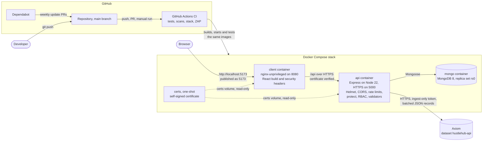

**Local development:**

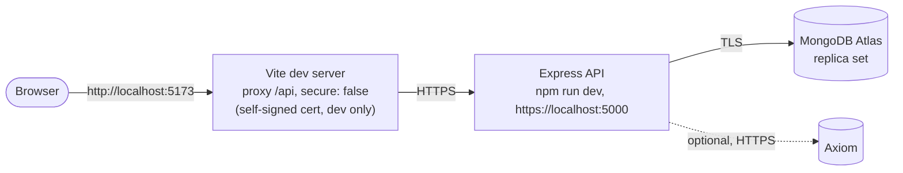

### Request pipeline

Every request passes through the same middleware, in this order
(`api/src/app.js`):

1. **Request id and access log**: a new `crypto.randomUUID()` id, returned
   in `X-Request-Id`, and one access log line when the response is done.
2. **Helmet**: security headers and the strict CSP.
3. **CORS**: only `CLIENT_ORIGIN` is accepted.
4. `GET /api/health` is answered here, before any rate limit.
5. **General rate limit**: 100 requests per 15 minutes per IP.
6. **Body parsers**, capped at 10kb.
7. **NoSQL sanitiser**: removes keys starting with `$` or containing `.`.
8. **Routers**, in this order on each route: `protect` (JWT plus the user
   loaded from the database), `requireRole`, the route's own rate limit,
   validators, `validateObjectId`, `requireOwnership`, then the controller
   and the Mongoose models.
9. **404 handler and the central error handler**, which formats every
   error as `{ "success": false, "error": "..." }` and never leaks a stack
   trace, file path or config value.

### Data model

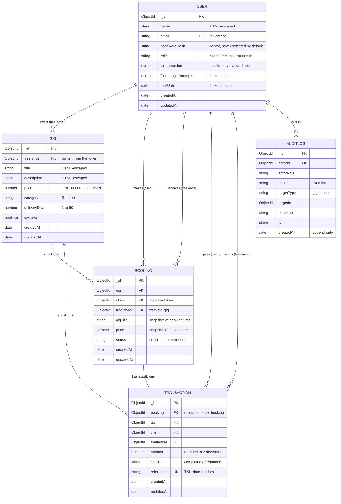

Every booking stores a snapshot of the gig's title and price and has
exactly one transaction (a unique index on `transaction.booking`). The
owner and the parties on every record come from the verified token and
the database, never from the request. The user also has a
`firstFailedLoginAt` and `lastFailedLoginAt` for the lockout; every hidden
field is `select: false` and removed from every JSON response.

### Project structure

```text
api/                            Express backend (its own Dockerfile)
  src/
    app.js                      middleware pipeline and route mounting
    server.js                   starts HTTPS, cloud log shipping, crash and shutdown handlers
    config/                     db, env checks, CORS and Helmet (security.js), rate limits,
                                lockout policy, trust proxy, SARS tax tables (tax.js)
    routes/                     auth, admin, gigs, bookings, transactions, income
    controllers/                one per router
    models/                     User, Gig, Booking, Transaction, AuditLog
    middleware/                 protect and requireRole, requireOwnership, validators,
                                validateObjectId, sanitiser, rate limiters, request id and
                                access log, error handler
    utils/                      logger, redaction, request context, event catalogue, log
                                shipper, lockout, audit helper, token, password, money,
                                tax calculator, tax year, tax estimate, regex escaping
  test/                         21 unit test files (Node's built-in test runner)
  scripts/                      certs, seed:admin, clean:test, start:test, log:test, healthcheck
  postman/                      main and rate limit Postman collections
  certs/                        local self-signed certificate (git-ignored) and its README
client/                         React frontend (Vite, its own Dockerfile)
  src/
    api/                        fetch wrapper (client.js) and one file per resource
    components/, pages/         UI, with tests next to the code (*.test.jsx)
    context/, utils/, styles/   auth provider, helpers, global CSS
    test/                       Vitest setup, render helper, security header test
  securityHeaders.js            the client's CSP and headers, used by Vite and nginx
  nginx.conf                    serves the build and proxies /api with TLS verification
docker/                         certificate image and the smoke test
docker-compose.yml              the stack; docker-compose.test.yml is a test-only override
.github/                        workflow (ci.yml), Dependabot, CI helper scripts
.semgrep/, .zap/                Semgrep runner and rule packs, ZAP rules
docs/                           screenshots, test, pipeline, static analysis and logging evidence
```

## 3. Tech stack

Versions are the ones installed from the lock files.

| Layer | Technology |
|---|---|
| Frontend | React 19.3, React Router 7.18, Vite 8.3. No UI or chart library: the income chart is hand-drawn SVG |
| Backend | Node.js 22, Express 4.22, Mongoose 9.11 |
| Database | MongoDB 8.0 (replica set) in Docker, or MongoDB Atlas for local development |
| Authentication | bcryptjs 2.4 (password hashing), jsonwebtoken 9.0 (JWT) |
| Security middleware | helmet 7.2, cors 2.8, express-rate-limit 8.7, express-validator 7.3, express-mongo-sanitize 2.2 |
| Logging | Our own structured logger and shipper (Node's built-in `fetch` and `AsyncLocalStorage`, no logging library); Axiom as the cloud logging platform |
| API tests | Node's built-in test runner (unit tests); Postman collections run with Newman 6 |
| Frontend tests | Vitest 5, React Testing Library 16, jsdom |
| Static analysis | ESLint 9 with eslint-plugin-security, eslint-plugin-react and eslint-plugin-react-hooks; Semgrep Community Edition 1.184 |
| Containers | Docker and Docker Compose. Images: `node:22.23.4-alpine3.24`, `nginxinc/nginx-unprivileged:1.31.7-alpine3.24`, `alpine:3.24.4` (the Dockerfile base images are pinned by version and digest) and `mongo:8.0.34-noble` (pinned by version in Compose) |
| CI/CD and scanning | GitHub Actions, Dependabot, gitleaks, hadolint, actionlint, zizmor, Trivy, OWASP ZAP |

## 4. Getting started

There are two ways to run HustleHub+. They don't share data: Docker uses
its own MongoDB unless you point it at Atlas.

- **A. Local development with npm**: the API and the client run on your
  machine, with MongoDB Atlas (or a local replica set).
- **B. Docker Compose**: the whole stack in containers with one command.

### Prerequisites

| Dependency | Version | Needed for |
|---|---|---|
| Node.js | **22 or newer** (22.22+ or 24.15+; the client's test tools don't support odd-numbered releases) | A, and running the tests and the smoke test. `engines` is set in both `package.json` files |
| npm | comes with Node | A: `npm ci` and the scripts |
| Git | any recent | Cloning. On Windows, Git for Windows also provides OpenSSL |
| MongoDB | MongoDB Atlas (free tier) or a local MongoDB running as a **replica set** | A. Bookings use multi-document transactions, which need a replica set (every Atlas cluster is one). See [Getting a MONGO_URI](#getting-a-mongo_uri) |
| OpenSSL | any recent, used through `npm run certs` | A: the local HTTPS certificate |
| Docker Desktop, or Docker Engine with the Compose plugin | recent | B, and the Semgrep, Trivy, gitleaks and ZAP scans |
| Newman | 6, run through `npx` (nothing to install) | Running the Postman collections |

### Environment variables

Secrets live only in the git-ignored `.env` files: `api/.env` for option A
and the root `.env` (next to `docker-compose.yml`) for option B. Copy them
from `api/.env.example` and `.env.example`, which hold placeholders only.
The client needs **no** env file: it only calls relative `/api/...` URLs.

Every variable the API reads:

| Variable | Required? | What it does | Where |
|---|---|---|---|
| `MONGO_URI` | **Required** (Docker defaults to its own mongo container) | MongoDB connection string | `api/.env`; optional in the root `.env` |
| `JWT_SECRET` | **Required** | Signs the login tokens. Use a long random string; at least 32 characters when `NODE_ENV=production`, or the API refuses to start | both |
| `JWT_EXPIRES_IN` | Optional (default `1h`) | How long a token stays valid | both |
| `CLIENT_ORIGIN` | Optional in development (default `http://localhost:5173`), **required in production** | The only browser origin the API accepts (CORS) and allows in its CSP. Exact origin, no trailing slash. Compose sets it | `api/.env` |
| `ADMIN_EMAIL`, `ADMIN_PASSWORD`, `ADMIN_NAME` | Required for the admin seed (`ADMIN_NAME` defaults to `Administrator`) | The admin account the seed script creates. Password at least 12 characters | both |
| `PORT` | Optional (default `5000`) | API port. The Vite proxy and the Postman collections expect 5000 | `api/.env` |
| `NODE_ENV` | Optional (default `development`) | `production` forces the strict rate limits and lockout, requires `CLIENT_ORIGIN`, checks the `JWT_SECRET` length and makes JSON the default log format. Compose sets `production` | `api/.env` |
| `TRUST_PROXY` | Optional (default off) | Number of reverse proxies in front of the API (1 in Compose), so rate limits see the real client IP. Only a whole number from 1 to 5 is accepted; `true` is refused | set by Compose |
| `RATE_LIMIT_LOGIN_MAX`, `RATE_LIMIT_REGISTER_MAX`, `RATE_LIMIT_BOOKING_MAX`, `RATE_LIMIT_PASSWORD_CHANGE_MAX`, `RATE_LIMIT_GENERAL_MAX` | Optional, local testing only | Raise a limiter's maximum. **Ignored when `NODE_ENV=production`**. `npm run start:test` and the Compose test override set them | `api/.env` (commented out) |
| `LOCKOUT_MAX_ATTEMPTS`, `LOCKOUT_WINDOW_MINUTES`, `LOCKOUT_DURATION_MINUTES` | Optional, local testing only | Change the account lockout policy (default 5 failures in 15 minutes lock for 15 minutes). **Ignored when `NODE_ENV=production`** | `api/.env` (commented out) |
| `LOG_FORMAT` | Optional | `pretty` (readable lines, the default in development) or `json` (the default in production and Docker) | both |
| `LOG_SHIPPING_URL`, `LOG_SHIPPING_TOKEN` | Optional (empty means off) | Cloud logging to Axiom: `https://<edge-domain>/v1/ingest/<dataset>` and an ingest-only API token. See [Logging and monitoring](#14-logging-and-monitoring) | both |
| `LOG_SHIPPING_IN_TEST` | Optional | Set to `1` to ship logs from a test run anyway (for a demo) | `api/.env` |

Two more are read but never set by hand: `HUSTLEHUB_TEST_RUN` is set by
`npm run start:test` to mark a test run, and `NODE_TEST_CONTEXT` is set by
Node's own test runner. Both keep cloud log shipping off. Docker Compose
also reads `API_TEST_PORT` from your shell for the test override (see
[Docker](#13-docker)).

### A. Local development with npm

The API and the client are separate projects; run each in its own
terminal.

**1. API** (`api/`):

```bash
cd api
npm ci                    # exact versions from package-lock.json
cp .env.example .env      # PowerShell: Copy-Item .env.example .env
# edit api/.env: MONGO_URI, JWT_SECRET, ADMIN_EMAIL, ADMIN_PASSWORD
npm run certs             # creates api/certs/key.pem and cert.pem (git-ignored)
npm run seed:admin        # creates the admin account; safe to run again
npm run dev               # https://localhost:5000, restarts when a file in src/ changes
```

- `npm run certs` works the same in Git Bash, PowerShell, macOS and
  Linux. To run OpenSSL by hand, see [`api/certs/README.md`](api/certs/README.md).
- **Without the certificate** the API starts on plain HTTP and logs a
  warning. The client proxy and the Postman collections expect HTTPS, so
  run `npm run certs` and restart.
- The API checks `JWT_SECRET` and `MONGO_URI` before it starts, connects
  to MongoDB before it listens, and exits with a safe message (never the
  URI) if either fails.
- Check it: `curl -k https://localhost:5000/api/health`. Browsers and
  Postman warn about the self-signed certificate; that's expected locally.

**2. Client** (`client/`), with the API running:

```bash
cd client
npm ci
npm run dev               # http://localhost:5173
```

Vite forwards every `/api` request to `https://localhost:5000`. It skips
the certificate check (`secure: false`) only because the local
certificate is self-signed; this setting is dev-only. To try the
production build under the real CSP, stop the dev server and run
`npm run build` then `npm run preview` (same port, so CORS still
matches).

**Other API scripts**

| Script | What it does |
|---|---|
| `npm start` | Starts the API once, without watching for changes. `npm run dev` uses Node's built-in `node --watch-path=src`, so it restarts only when a file in `src/` changes (not for tests, scripts or logs) |
| `npm run start:test` | Relaxed rate limits for the main Newman run. Refuses to run in production. Never ships logs to the cloud |
| `npm run start:test:strict` | The real (strict) limits, marked as a test run, for the rate limit collection |
| `npm run clean:test` | Removes the throwaway test users (`test-...@example.com`, `role-...@example.com`) with their gigs, bookings and transactions. Never deletes an admin. Refuses to run in production |
| `npm run log:test` | Sends one labelled test event to Axiom and prints only the HTTP status and the ingested and failed counts |
| `npm test`, `npm run lint` | Unit tests and ESLint (see [Testing](#10-testing)) |

#### Getting a MONGO_URI

**MongoDB Atlas (free, what this project was tested on):**

1. Create a free account at <https://www.mongodb.com/cloud/atlas> and a
   free (M0) cluster.
2. **Database Access**: add a database user. Use a password of **plain
   letters and numbers only** (symbols such as `@`, `:` or `/` would have
   to be URL-encoded in the connection string), with the "Read and write
   to any database" role.
3. **Network Access**: **Add Current IP Address**.
4. **Connect**, then **Drivers**, and copy the connection string. Put your
   database user's password in place of `<password>` and add the database
   name `hustlehub` after the host, before the `?`:
   `mongodb+srv://<user>:<password>@<your-cluster-host>/hustlehub?retryWrites=true&w=majority`
5. Paste it into `api/.env` as `MONGO_URI`. If the `mongodb+srv://` string
   fails with `querySrv ECONNREFUSED`, see [Troubleshooting](#troubleshooting).

**Local MongoDB:** `mongodb://localhost:27017/hustlehub`. A standalone
MongoDB serves everything except bookings, because MongoDB only allows
multi-document transactions on a replica set. To use a local database,
start `mongod` with `--replSet rs0`, run `rs.initiate()` once in
`mongosh`, and keep the same URI. This project was tested on Atlas and in
Docker, not on a local replica set.

### B. Docker Compose

Needs only Docker (no local Node, MongoDB or OpenSSL). Port **5173** must
be free, so stop `npm run dev` first.

```powershell
# 1. Root .env (git-ignored). Compose refuses to start without JWT_SECRET.
Copy-Item .env.example .env
node -e "console.log(require('crypto').randomBytes(48).toString('hex'))"
notepad .env    # paste the value after JWT_SECRET=, set ADMIN_PASSWORD (12+ characters)

# 2. Build and start; --wait returns once every service is healthy
docker compose up -d --build --wait
docker compose ps

# 3. Create the admin account (once; running it again changes nothing)
docker compose run --rm seed

# 4. Optional: smoke test through the client container
node docker/smoke-test.mjs
```

In bash, use `cp .env.example .env` and
`sed -i "s/^JWT_SECRET=.*/JWT_SECRET=$(openssl rand -hex 48)/" .env`
for step 1. `docker compose ps` should show `mongo`, `api` and `client` as
`Up ... (healthy)` and `certs` as `Exited (0)`, which is correct for a
one-shot step. If `LOG_SHIPPING_URL` and `LOG_SHIPPING_TOKEN` are set in
the root `.env`, the API container ships its logs to Axiom.

Stop with `docker compose down` (keeps the data) or `docker compose down -v`
(also deletes the database and the certificate). Container details,
hardening and the test override are in [Docker](#13-docker).

### The admin account

Admins can't sign up through the app: registration only accepts `client`
or `freelancer`, and `"role": "admin"` gets a `400`. The admin is created
by the seed script from `ADMIN_EMAIL`, `ADMIN_PASSWORD` (12+ characters)
and `ADMIN_NAME`:

- npm: `cd api; npm run seed:admin`
- Docker: `docker compose run --rm seed` (the `ADMIN_*` values exist only
  in that short-lived container, never in the running API)

If the account already exists, the script changes nothing. The admin can
change the password later on the Account page.

### URLs

| What | npm (A) | Docker (B) |
|---|---|---|
| The app | <http://localhost:5173> | <http://localhost:5173> |
| API | `https://localhost:5000/api/...` (also through the Vite proxy) | Not published; reached through `http://localhost:5173/api/...` |
| Health check | `https://localhost:5000/api/health` | `http://localhost:5173/api/health` |
| API for Newman in Docker | n/a | `https://localhost:5000` with the test override only |

## 5. Using the app

### Roles

| Role | How you get it | What it can do |
|---|---|---|
| `client` | Default at registration | Browse gigs, book gigs, see their own bookings and transactions |
| `freelancer` | Chosen at registration | Create, edit and delete their **own** gigs, see the bookings on their gigs, see their income and tax estimate |
| `admin` | Only through the seed script | List all users and transactions, remove any gig, read the audit log |

Every role can change its own password and sign out of all its devices.
Nobody can change another user's password. Each user has exactly one
role, stored in MongoDB and read from there on every request, so a role
change takes effect immediately.

### Screens by role

| Role | Screens |
|---|---|
| Anyone | Home, Register (client or freelancer only), Log in |
| Client | Browse gigs (search, category, price range, pages), Gig detail with **Book this gig** and a simulated payment confirmation, My bookings, My transactions, Account |
| Freelancer | Browse gigs, My gigs (New, Edit, Activate or Deactivate, Delete with confirmation), New and Edit gig form, Bookings on my gigs, Income dashboard with the tax estimate, an **Edit** link on their own gig pages, Account |
| Admin | Browse gigs, Users, All transactions, **Audit log** (filter by action), **Delete as admin** on any gig page, Account |

A logged-out visitor who opens a protected page is sent to Log in, and a
logged-in user with the wrong role sees a "Not allowed" page. These are
conveniences only: the API enforces every rule itself.

### Main flows

1. **Register and log in.** Pick client or freelancer. A wrong password,
   an unknown email and a locked account all show the same "Invalid email
   or password".
2. **Freelancer creates a gig.** My gigs, then New gig: title,
   description, price (1 to 100 000 rand, 2 decimals), delivery days (1
   to 90) and a category. The owner is always the logged-in freelancer.
3. **Client books it.** Browse gigs, open the gig, **Book this gig**, then
   **Confirm booking**. The confirmation shows the price from the database
   and a "Payment is simulated" notice. The booking and its transaction
   are saved together and the transaction reference (`TXN-...`) is shown.
4. **Both sides see it.** The client's My bookings and My transactions,
   the freelancer's Bookings on my gigs and Income dashboard, and the
   admin's All transactions all show the same reference.
5. **Freelancer checks the tax estimate.** The Income dashboard shows the
   estimated South African income tax for the selected tax year (see
   [Tax estimation](#7-tax-estimation)).
6. **Account security.** On the Account page, change the password (every
   other session ends) or **Sign out of all devices** (every session
   ends). Five wrong passwords in 15 minutes lock the account for 15
   minutes.
7. **Admin review.** The admin's Audit log lists admin gig removals,
   password changes, sign-outs and lockouts.

### How the client handles text and sessions

- **Text.** The API HTML-escapes free text before saving it (`<b>` is
  stored as `&lt;b&gt;`). The client decodes exactly those entities for
  display (`client/src/utils/text.js`) and React renders the result as
  plain text. There is no `dangerouslySetInnerHTML` and no HTML is built
  from strings, so a gig titled `` shows up
  as those literal characters. The edit form sends back exactly what the
  freelancer typed, so text never double-escapes.
- **Session.** Only the JWT is stored, in `localStorage` (see
  [the trade-off](#jwt-in-localstorage-the-trade-off)). On start-up the
  client checks it with `GET /api/auth/me`. If the API later answers
  `401`, the token is cleared and the user goes to Log in. The client
  never logs tokens or request data.

## 6. API reference

Base URL: `https://localhost:5000` (through the client: `/api/...`). "Token"
means a valid `Authorization: Bearer <token>` header. Every response is
`{ "success": true, "data": ... }` or `{ "success": false, "error": "..." }`.
Every route except the health check also counts towards the **general**
limit (100 requests per 15 minutes per IP).

| Method | Path | Auth | Roles | Rate limit | Notes |
|---|---|---|---|---|---|
| GET | `/api/health` | None | Anyone | None | `{ "status": "ok" }` and nothing else. Not logged |
| POST | `/api/auth/register` | None | Anyone | Register: 10 per hour per IP | `role` is `client` (default) or `freelancer`; `admin` gets `400`. Duplicate email: `409` |
| POST | `/api/auth/login` | None | Anyone | Login: 5 **failed** per 15 min per IP; plus the account lockout | The same `401 Invalid email or password` for a wrong password, an unknown email and a locked account |
| GET | `/api/auth/me` | Token | Any | General | The current user |
| POST | `/api/auth/change-password` | Token | Any (own account) | Password change: 5 per 15 min per user | Body `{ currentPassword, newPassword }` only. Wrong current password: `400`, not `401`. Success returns a new token and ends every other session |
| POST | `/api/auth/logout-all` | Token | Any (own account) | General | Empty body only. Ends every session, this one included |
| GET | `/api/admin/users` | Token | Admin | General | All users, newest first, no password hashes |
| GET | `/api/admin/transactions` | Token | Admin | General | Query `page`, `limit` (max 50) only |
| DELETE | `/api/admin/gigs/:id` | Token | Admin | General | Deletes any gig, or deactivates it if it has bookings. Written to the audit log |
| GET | `/api/admin/audit-logs` | Token | Admin | General | Query `page`, `limit` (max 50), `action` only. Read only |
| GET | `/api/gigs` | Token | Any | General | Active gigs. Query `page` (max 1000), `limit` (max 50), `category`, `q` (max 50 characters, literal text), `minPrice`, `maxPrice` only |
| GET | `/api/gigs/mine` | Token | Freelancer | General | Your own gigs, including inactive ones |
| GET | `/api/gigs/:id` | Token | Any | General | Inactive gigs only for their owner (`404` for everyone else) |
| POST | `/api/gigs` | Token | Freelancer | General | Exactly `title`, `description`, `price`, `category`, `deliveryDays`. The owner comes from the token |
| PUT | `/api/gigs/:id` | Token | Freelancer, **owner only** | General | Any of `title`, `description`, `price`, `category`, `deliveryDays`, `isActive` |
| DELETE | `/api/gigs/:id` | Token | Freelancer, **owner only** | General | Deletes the gig, or deactivates it if it has bookings |
| POST | `/api/bookings` | Token | Client | Booking: 10 per 10 min per user | Body `{ "gigId": "..." }` only. Creates the booking and its transaction; returns a simulated payment confirmation |
| GET | `/api/bookings/mine` | Token | Client, Freelancer | General | Clients: their bookings. Freelancers: bookings on their gigs |
| GET | `/api/bookings/:id` | Token | The booking's client or freelancer | General | Anyone else gets `403` |
| GET | `/api/transactions/mine` | Token | Client, Freelancer | General | What you paid, or what you were paid |
| GET | `/api/income` | Token | Freelancer | General | `{ totalEarned, bookingCount, items }` from completed transactions |
| GET | `/api/income/tax-estimate` | Token | Freelancer | General | Query `taxYear` only (optional). See [Tax estimation](#7-tax-estimation) |

Unknown fields and query parameters are rejected with `400` on every
route above that lists its fields with "only" or "exactly". Registration
and login read only their named fields and ignore anything else.

### Route audit

Every route and its middleware, in order, read from the route files.
Every request first passes the global pipeline (see
[Request pipeline](#request-pipeline)).

| Method | Route | Middleware, in order |
|---|---|---|
| GET | `/api/health` | none (registered before the general limit) |
| POST | `/api/auth/register` | registerLimiter, validators |
| POST | `/api/auth/login` | loginLimiter, validators |
| GET | `/api/auth/me` | protect |
| POST | `/api/auth/change-password` | protect, passwordChangeLimiter (per user), validators (exact fields) |
| POST | `/api/auth/logout-all` | protect, validators (empty body) |
| all | `/api/admin/*` | router-level protect, requireRole(admin), then per route: |
| GET | `/api/admin/users` | (none) |
| GET | `/api/admin/transactions` | pagination validators (exact params) |
| DELETE | `/api/admin/gigs/:id` | validateObjectId |
| GET | `/api/admin/audit-logs` | query validators (exact params) |
| all | `/api/gigs/*` | router-level protect, then per route: |
| GET | `/api/gigs` | query validators (exact params) |
| GET | `/api/gigs/mine` | requireRole(freelancer) |
| GET | `/api/gigs/:id` | validateObjectId (inactive gigs only for the owner, in the controller) |
| POST | `/api/gigs` | requireRole(freelancer), body validators (exact fields) |
| PUT | `/api/gigs/:id` | requireRole(freelancer), validateObjectId, **requireOwnership**, body validators (exact fields) |
| DELETE | `/api/gigs/:id` | requireRole(freelancer), validateObjectId, **requireOwnership** |
| all | `/api/bookings/*` | router-level protect, then per route: |
| POST | `/api/bookings` | requireRole(client), bookingLimiter (per user), validators (gigId only) |
| GET | `/api/bookings/mine` | requireRole(client, freelancer) |
| GET | `/api/bookings/:id` | validateObjectId, **requireOwnership** (client or freelancer) |
| GET | `/api/transactions/mine` | router-level protect, requireRole(client, freelancer) |
| GET | `/api/income` | protect, requireRole(freelancer) |
| GET | `/api/income/tax-estimate` | protect, requireRole(freelancer), validators (`taxYear` only) |

Every route except health, register and login requires a valid JWT.
Every role-restricted route uses `requireRole`. Every route that reads or
changes one specific gig or booking validates the id and checks
ownership (or, for reading a gig, that it is active or yours). The "mine"
routes never take an id from the request: they filter by `req.user.id`.

### Booking and transaction flow

1. **The client books a gig.** `POST /api/bookings` takes only a `gigId`.
   Any other field (price, freelancer, client, status) is a `400`. The gig
   must exist and be active, otherwise `404`.
2. **The booking is created.** The freelancer and the price come from the
   gig in the database. The booking keeps a snapshot of the gig's title
   and price, so later edits don't change what was booked.
3. **The transaction is created in the same database transaction**
   (`withTransaction` on a Mongoose session). If anything fails part-way,
   neither is saved. A unique index allows exactly one transaction per
   booking. Payment is simulated: the transaction is `completed` with a
   reference such as `TXN-20261009-9F3A1C2B7D4E`.
4. **Income comes from completed transactions.** `GET /api/income` adds up
   the freelancer's `completed` transactions (refunded ones are left out).


Money is stored as a number rounded to 2 decimals and totals are rounded
the same way. Each booking is logged as `BOOKING_CREATED` and
`TRANSACTION_CREATED`; a refused booking as `BOOKING_FAILED`.

## 7. Tax estimation

Freelancers get an estimate of the South African income tax on what they
earned through HustleHub+, on the **Income dashboard** (`/income`) and from
`GET /api/income/tax-estimate`. It is a planning aid, not tax advice: the
API returns a disclaimer with every estimate and the dashboard shows it
next to the figures.

### How the estimate is calculated

1. **Gross income.** All of the freelancer's `completed` transactions
   whose date falls in the selected tax year are added up (refunded ones
   are left out). This total is treated as taxable income.
2. **Sliding scale.** Each slice of that income is taxed at its bracket's
   rate: the first R245 100 at 18%, the next slice up to R383 100 at 26%,
   and so on. The sum is the *tax before rebate*.
3. **Primary rebate.** The primary rebate (R17 820 for the 2027 tax year)
   is subtracted. The result is never allowed to go below zero, so anyone
   earning the tax-free threshold (R99 000) or less pays R0.
4. **Summary figures.** Take-home = gross − estimated tax. Effective rate =
   estimated tax ÷ gross × 100 (0% when gross is 0).

### Tax tables used

The brackets, rebate and threshold come from the SARS page
[Rates of Tax for Individuals](https://www.sars.gov.za/tax-rates/income-tax/rates-of-tax-for-individuals/),
checked on 7 November 2026. They live as data in
[`api/src/config/tax.js`](api/src/config/tax.js), with the source and date
in a comment.

| `taxYear` | Period | SARS name | Primary rebate | Tax-free threshold (under 65) |
|---|---|---|---|---|
| `2026` (current) | 1 March 2026 to 28 February 2027 | 2027 tax year | R17 820 | R99 000 |
| `2025` | 1 March 2025 to 28 February 2026 | 2026 tax year | R17 235 | R95 750 |
| `2024` | 1 March 2024 to 28 February 2025 | 2025 tax year | R17 235 | R95 750 |
| `2023` | 1 March 2023 to 29 February 2024 | 2024 tax year | R17 235 | R95 750 |

SARS lists the 2025 and 2026 tax years as "no changes", so those two use
the 2024 tax year's brackets. 2027 tax year brackets (the current year):

| Taxable income (R) | Rate of tax (R) |
|---|---|
| 0 to 245 100 | 18% of taxable income |
| 245 101 to 383 100 | 44 118 + 26% of taxable income above 245 100 |
| 383 101 to 530 200 | 79 998 + 31% of taxable income above 383 100 |
| 530 201 to 695 800 | 125 599 + 36% of taxable income above 530 200 |
| 695 801 to 887 000 | 185 215 + 39% of taxable income above 695 800 |
| 887 001 to 1 878 600 | 259 783 + 41% of taxable income above 887 000 |
| 1 878 601 and above | 666 339 + 45% of taxable income above 1 878 600 |

The calculator works the tax out bracket by bracket rather than copying
SARS's fixed amounts, and a unit test checks that this gives exactly the
SARS base amount (44 118, 79 998, ...) at the bottom of every bracket, and
that tax at the threshold equals the rebate. That catches a typo in the
config.

### Worked example

A freelancer earns **R300 000** in the 2027 tax year. The same numbers are
asserted in [`api/test/taxCalculator.test.js`](api/test/taxCalculator.test.js).

| Step | Calculation | Amount |
|---|---|---|
| First bracket | 18% × R245 100 | R44 118.00 |
| Second bracket | 26% × (R300 000 − R245 100) = 26% × R54 900 | R14 274.00 |
| Tax before rebate | R44 118 + R14 274 | R58 392.00 |
| Less primary rebate | R58 392 − R17 820 | **R40 572.00 estimated tax** |
| Take-home | R300 000 − R40 572 | **R259 428.00** |
| Effective rate | R40 572 ÷ R300 000 × 100 = 13.524% | **13.52%** |

### Money and dates

- Amounts are summed as whole cents in the database query, and the
  calculator works in integer cents and hundredths of a cent, so there is
  no floating point drift. The total tax is rounded to the cent once,
  half up, at the end. Breakdown lines are rounded on their own for
  display, so in rare cases they can differ from the total by a cent.
  Every amount in the response is a number with at most 2 decimals.
- A tax year runs from 1 March to the last day of February. Its start and
  end, and the monthly buckets, are worked out in South African time
  (UTC+02:00, no daylight saving), so a booking at 00:30 on 1 March counts
  in the new tax year even though it is still 28 February in UTC.
- Without `taxYear`, the API uses the tax year containing today. If the
  tables for a new tax year haven't been added to `config/tax.js` yet, it
  falls back to the newest year that is configured. It never guesses rates.

### Assumptions and limitations

- Resident individual **under 65**: only the primary rebate is applied
  (no secondary or tertiary rebate).
- **No deductions**: no business expenses, retirement fund contributions
  or medical scheme credits.
- **No UIF**, provisional tax payments, or income from outside HustleHub+.
- **Income to date is treated as the whole year's taxable income.** It is
  not projected forward, so early in the tax year the estimate is low.
- Only the tax years in the table above are supported. Any other
  `taxYear` gets a `400`.

### The endpoint

`GET /api/income/tax-estimate?taxYear=2026` runs protect →
requireRole(freelancer) → query validation. The freelancer is always taken
from the verified token, never from the request. Clients and admins get
`403`, no token gets `401`. `taxYear` must be a single 4-digit year that is
in the table, and any other query parameter (for example `freelancerId`)
is rejected with `400` by `checkExact`. The query uses the existing
`{ freelancer, status, createdAt }` index on transactions, and each request
is logged as a plain info line with the tax year (the request id and
user id come from the request context). The
general API rate limiter applies. Response (`data`):

```json
{
  "taxYear": { "label": "1 March 2026 to 28 February 2027 (SARS 2027 tax year)", "start": "2026-03-01", "end": "2027-02-28" },
  "totals": { "gross": 300000, "taxBeforeRebate": 58392, "estimatedTax": 40572, "takeHome": 259428, "effectiveRatePercent": 13.52 },
  "rebate": 17820,
  "taxFreeThreshold": 99000,
  "breakdown": [{ "from": 0, "to": 245100, "ratePercent": 18, "amountInBracket": 245100, "tax": 44118 }, "... 7 brackets, the top one has to: null"],
  "monthly": [{ "month": "2026-03", "income": 0, "bookings": 0 }, "... all 12 months, March to February"],
  "assumptions": ["Resident individual under 65, so only the primary rebate applies.", "..."],
  "disclaimer": "This is an estimate for planning only, not tax advice and not a SARS assessment. ...",
  "source": { "name": "SARS - Rates of Tax for Individuals", "url": "https://www.sars.gov.za/...", "checkedOn": "2026-11-07" },
  "availableTaxYears": [2026, 2025, 2024, 2023]
}
```

### The dashboard

The dashboard (`client/src/pages/Income.jsx`) has a tax year selector,
four summary cards (total earned, estimated tax, take-home, effective
rate), a monthly income bar chart, the tax-by-bracket table with the
rebate, an assumptions and disclaimer panel, and the existing per-booking
income table. The chart (`components/MonthlyIncomeChart.jsx`) is
hand-drawn SVG with no chart library, so the strict client CSP
(`style-src 'self'`, no `'unsafe-inline'`) needed no change. It uses only
SVG attributes and CSS classes, no inline styles and no
`dangerouslySetInnerHTML`. It has an `aria-label` summary, and the same
figures are in a visually hidden table for screen readers.

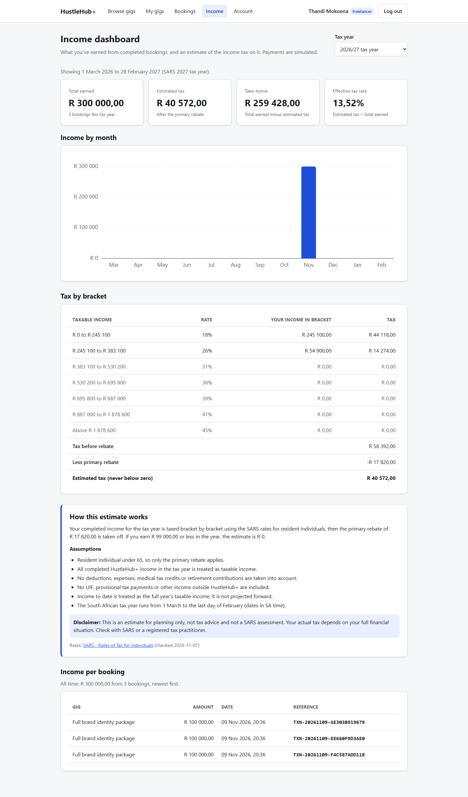

The same R 300 000 example as the worked example above, on the real dashboard. The chart shows the value of a month on hover. The phone-width view is
[`part3-06-dashboard-phone.png`](docs/screenshots/part3-06-dashboard-phone.png).

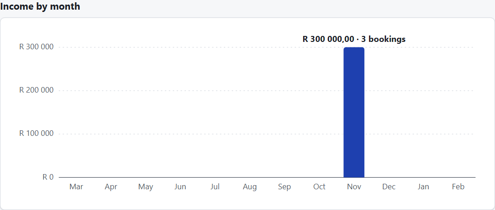

**Tests:** `api/test/` (run with `npm test` in `api/`, Node's built-in test
runner, no database or secrets needed) covers the calculator, tax-year
dates, config consistency and the response builder. The Newman **Income**
folder covers the endpoint (200 with values, 403 for client and admin,
401 without a token, 400 for a bad `taxYear` or an unknown parameter).
`Income.test.jsx` and `MonthlyIncomeChart.test.jsx` cover the dashboard.

## 8. Security implementation

Security is layered: every request passes several independent checks, so
a gap in one is caught by another. **Every authentication, authorisation
and ownership rule is enforced by the API.** Hiding a button in React is
a convenience, not security: calling the API directly with Postman or
curl gets exactly the same `401`, `403` and `400` responses. Section 9
maps each threat to these controls and to the evidence that they work.

### Authentication and passwords

- **Hashing:** passwords are hashed with **bcryptjs** (10 salt rounds,
  `api/src/utils/password.js`) before they are stored, and are never
  logged or returned. The hash field is `select: false` and removed by
  `toJSON`. bcryptjs was chosen over the native `bcrypt` package to avoid
  its native build chain, which pulled in high and critical npm audit
  findings, and to make setup the same on every team member's OS.
- **Password rules:** at least 8 characters with a number, and at most
  **72 bytes** (bcrypt ignores everything after 72 bytes), counted in
  bytes so an emoji counts as 4. The seed script asks for at least 12
  characters for the admin password.
- **No enumeration:** a wrong password, an unknown email and a locked
  account all return the same `401 Invalid email or password`. Login
  always runs a bcrypt compare (against a dummy hash for an unknown email
  or a locked account), so response times don't reveal valid accounts. A
  duplicate registration gets a generic `409`.
- **Account lockout, change password and session revocation:** see
  [Extra security features](#extra-security-features).

### JWT and sessions

- The token carries only the user's `id`, `role` and token version
  (`tv`), never the password hash: a JWT payload is signed, not
  encrypted.
- `JWT_SECRET` comes only from the environment. The API refuses to start
  without it, and in production unless it is at least 32 characters.
  Tokens expire after `JWT_EXPIRES_IN` (default 1 hour).
- `protect` verifies the signature, then **loads the user from the
  database** on every request: the role comes from the database, not the
  token; a deleted user's token stops working at once; and a token whose
  version no longer matches (after a password change or "sign out of all
  devices") is rejected.
- Missing, expired, tampered and revoked tokens all get the same generic
  `401`. The logs keep the difference (`ACCESS_DENIED` with a reason).

### RBAC and ownership

| Action | Anyone | Client | Freelancer | Admin |
|---|---|---|---|---|
| Register (as client or freelancer only), log in | Yes | Yes | Yes | Yes (log in) |
| Change own password, sign out everywhere | | Yes | Yes | Yes |
| Browse active gigs, view a gig | | Yes | Yes | Yes |
| Create a gig | | | Yes | |
| Update or delete a gig | | | **Own gigs only** | Delete any (admin route) |
| Book a gig | | Yes | | |
| See bookings and transactions | | Own | On own gigs | All transactions |
| Income and tax estimate | | | Own | |
| List users, read the audit log | | | | Yes |

- `requireRole(...)` guards every role-restricted route. A wrong role gets
  a generic `403` that doesn't say which role was needed.
- `requireOwnership(...)` loads the record and compares its owner (a
  gig's freelancer; a booking's client or freelancer) with the user from
  the verified token and database, never with an id from the request.
  Missing records are `404`, someone else's are `403`.
- The whole `/api/admin` router is behind `protect` and
  `requireRole('admin')` at router level, so a new admin route can't be
  added without the guard.
- The owner, the client, the freelancer, the price and the status of a
  booking always come from the token and the database. Admins can't
  self-register; the admin account is created by the seed script.

### Validation and sanitisation

- **express-validator on every route that takes input.** Types are checked
  with `typeof` (so an array can't pass as a string), lengths and ranges
  are enforced, categories and roles come from fixed lists, and ids must
  be exactly 24 hex characters (`validateObjectId`).
- **Unknown fields are rejected** with `checkExact` on the gig, booking,
  change-password, logout-all, pagination, gig list, audit log and tax
  estimate routes, so a request can't set `freelancer`, `price`, `role` or
  `isActive` by adding them. Registration and login use only the fields
  they name and ignore anything else.
- **HTML escaping:** every free-text field other users see (gig title,
  description and category, and the user's name) is trimmed and
  HTML-escaped before it's saved.
- **NoSQL operator stripping:** express-mongo-sanitize removes any key that
  starts with `$` or contains `.` from the body, query and params before
  any route runs, and logs `INPUT_SANITIZED`. This is defence in depth on
  top of the validators.
- **Search** text is regex-escaped and capped at 50 characters.
- **Body limits:** 10kb on the API (`413`), 16k in nginx. Malformed JSON
  gets a clear `400`.

### Error handling

All errors pass through one central handler
(`api/src/middleware/errorHandler.js`). It logs server errors as
`ERROR_UNHANDLED` with the error's name, message and status only (no
stack trace, no file paths), returns a generic message for any unexpected
error, and never puts a stack trace, file path or config value in a
response. Schema and body parser errors get fixed, safe messages.

| Situation | Status | `error` message |
|---|---|---|
| Unknown route (`GET /api/nope?token=abc`) | `404` | `Route not found: GET /api/nope` (the query string is never echoed) |
| Malformed id | `400` | `Invalid id` |
| No token / tampered or revoked token | `401` | `Not authenticated - no token provided` / `Not authenticated - invalid or expired token` |
| Wrong password, unknown email or locked account | `401` | `Invalid email or password` (identical) |
| Wrong role, or not the owner | `403` | `You do not have permission to perform this action` |
| Malformed JSON / body over 10kb | `400` / `413` | `Request body is not valid JSON` / `Request body is too large` |
| Request from another origin | `403` | `Origin not allowed` |
| 6th failed login in 15 minutes from one IP | `429` | `Too many requests, please try again in 899 seconds.` |
| Any unexpected server error | `500` | `Something went wrong. Please try again later.` |

### Rate limits

| Limiter | Applies to | Limit | Counted per |
|---|---|---|---|
| Login | `POST /api/auth/login` | 5 **failed** attempts per 15 minutes (successful logins don't count) | IP |
| Register | `POST /api/auth/register` | 10 per hour | IP |
| Booking | `POST /api/bookings` | 10 per 10 minutes | Logged-in user |
| Password change | `POST /api/auth/change-password` | 5 per 15 minutes | Logged-in user |
| General | Everything under `/api` except the health check | 100 per 15 minutes | IP |

Going over a limit returns `429`, a `Retry-After` header, the standard
`RateLimit` and `RateLimit-Policy` headers, and
`{ "success": false, "error": "Too many requests, please try again in N seconds." }`.
Every hit is logged as `RATE_LIMIT_EXCEEDED` with the limiter name, IP and
route. The `RATE_LIMIT_*_MAX` overrides used for testing are **ignored
when `NODE_ENV=production`**. Behind nginx, `TRUST_PROXY=1` makes the
per-IP limits see the real client (see [Docker](#13-docker)).

### Security headers and the Content-Security-Policy

**API** (Helmet, configured explicitly in `api/src/config/security.js`),
with no `unsafe-inline` or `unsafe-eval` anywhere:

| Directive | Value |
|---|---|
| `default-src`, `script-src`, `style-src` | `'self'` |
| `img-src` | `'self' data:` |
| `connect-src` | `'self'` and `CLIENT_ORIGIN` |
| `object-src`, `frame-ancestors` | `'none'` |
| `base-uri`, `form-action` | `'self'` |

Also `Strict-Transport-Security` (1 year, including subdomains),
`X-Content-Type-Options: nosniff`, `Referrer-Policy: no-referrer`,
`X-Frame-Options: DENY`, `Cross-Origin-Opener-Policy: same-origin`,
`Cross-Origin-Resource-Policy: same-origin` and
`Cross-Origin-Embedder-Policy: require-corp`. `X-Powered-By` is removed.

**Client.** The client's policy is defined once, in
[`client/securityHeaders.js`](client/securityHeaders.js):

```text
default-src 'self'; script-src 'self'; style-src 'self'; img-src 'self' data:;
connect-src 'self'; object-src 'none'; base-uri 'self'; form-action 'self'
```

- **In Docker**, nginx sends it as a header plus `frame-ancestors 'none'`,
  `X-Content-Type-Options`, `Referrer-Policy`, `X-Frame-Options: DENY`,
  `Permissions-Policy` (camera, microphone, geolocation, payment and USB
  off) and the three cross-origin isolation headers. The nginx lines are
  generated from the same file at image build time, and `server_tokens`
  is off.
- **The built app** also carries the policy as a `<meta>` tag, added by a
  small Vite plugin; `npm run preview` sends the same headers as nginx.
  The build has no inline scripts, inline styles or event handler
  attributes, so nothing had to be loosened.
- A Vitest test (`client/src/test/securityHeaders.test.js`) fails if
  nginx, the preview server and the shared file ever disagree.
- `npm run dev` has no CSP on purpose: Vite's dev server injects inline
  scripts for hot reloading, which this policy would block.

### CORS and CSRF

CORS accepts only the origin in `CLIENT_ORIGIN`, never a wildcard, with
only `GET`, `POST`, `PUT` and `DELETE` and only the `Authorization` and
`Content-Type` headers. Credentials are off. A request or preflight from
any other origin gets `403 Origin not allowed` with no
`Access-Control-Allow-Origin` header, and is logged as `ACCESS_DENIED`
with the reason `cors_origin`.

There are no cookies: the JWT is sent in the `Authorization` header,
which a browser never adds by itself to a request from another site. So
a forged cross-site request has no credentials, and CSRF tokens aren't
needed.

### HTTPS and TLS

- The API serves HTTPS with a self-signed certificate (`npm run certs`
  locally; the one-shot `certs` container in Docker). Key and certificate
  are git-ignored and never in an image.
- In Docker, nginx proxies `/api` to the API over HTTPS with
  `proxy_ssl_verify on`, trusting only that certificate (whose SAN
  includes `api`), and always sends `Host: api` instead of the browser's
  own Host header.
- Logs go to Axiom over HTTPS only; the shipper refuses a plain `http`
  URL except to localhost in a test run.
- MongoDB Atlas connections use TLS. Inside Compose, MongoDB is on the
  internal network only (see [residual risks](#residual-risks-and-accepted-limitations)).

### Dependency audit

`npm audit` on 9 November 2026:

| Project | `npm audit --omit=dev` (what ships) | `npm audit` (including dev tools) |
|---|---|---|
| `api/` | **0 vulnerabilities** | **0 vulnerabilities** |
| `client/` | **0 vulnerabilities** | **0 vulnerabilities** |

Two dev-only findings were cleared at the end of Part 3. `npm audit fix`
updated `undici` (used by `jsdom` in the client tests) within its version
range. The api finding came from `minimatch` inside `nodemon`, and could
only be fixed with a major version that nodemon doesn't support, so
nodemon was removed: `npm run dev` now uses Node's own `--watch-path`. The pipeline
runs `npm audit --omit=dev --audit-level=high`, which passes. Newman is run
with `npx` instead of being a dependency, so its own tree adds nothing.

### JWT in localStorage: the trade-off

The client keeps the JWT in `localStorage`, which is acceptable for the
POE but has a known risk: **any script running on the page can read
`localStorage`**, so a single XSS bug would let an attacker steal the
token and act as the user. An `httpOnly` cookie would hide the token from
scripts, but would bring back CSRF and cookie configuration. The risk is
reduced by:

- **escaping on the way in:** user text is HTML-escaped before it is
  stored
- **React's escaping on the way out:** no `dangerouslySetInnerHTML` (the
  ESLint rule `react/no-danger` is on) and no HTML built from strings
- **a strict CSP** on the client and the API: `script-src 'self'` with no
  `unsafe-inline` or `unsafe-eval`
- **short-lived tokens** (1 hour) and **revocation**: "Sign out of all
  devices" or a password change ends a stolen token at once
- **the role isn't trusted from the token**, so a stolen token gives no
  more rights than the user has

### Extra security features

Three features added on top of the core security controls above. Each one
can be seen in the app and is covered by unit, Newman and (where there is a
UI) Vitest tests.

#### A. Account lockout

**Threat.** Slow password guessing against **one** account from **many** IP
addresses (a botnet, or credential stuffing spread out over time). The
per-IP login limiter can't see this, because every IP only tries a few
times.

**How it works.**
- **Policy:** 5 failed attempts within 15 minutes lock the account for 15
  minutes. Failures older than the window don't count, and a successful
  login resets everything. The policy lives in
  [`api/src/config/lockout.js`](api/src/config/lockout.js).
  `LOCKOUT_MAX_ATTEMPTS`, `LOCKOUT_WINDOW_MINUTES` and
  `LOCKOUT_DURATION_MINUTES` can change it for local testing only; they are
  ignored when `NODE_ENV=production`, like the rate limit overrides.
- **State:** `failedLoginAttempts`, `firstFailedLoginAt` (the start of the
  window), `lastFailedLoginAt` and `lockUntil` on the user. They are
  `select: false`, removed by `toJSON` from every response, and never put
  in the JWT. Accounts created before this feature simply don't have them,
  which counts as "no failures", so no migration is needed.
- **Atomic counting:** every attempt on an existing account first *claims*
  an attempt with one `findOneAndUpdate`. It only matches an unlocked
  account and uses an update pipeline to count the attempt (or start a new
  window) and set `lockUntil` on the attempt that reaches the limit, all
  inside the database. The password is only checked after a successful
  claim. With 10 wrong passwords sent in parallel against a fresh account,
  exactly 5 were checked, 5 were refused unchecked, and the account locked
  once.
- **No enumeration, by message or by timing:** a locked account never has
  its real password checked. A bcrypt compare against a dummy hash runs
  instead, exactly as it does for an unknown email. A wrong password, an
  unknown email and a locked account all return the **same** `401`
  `{"success":false,"error":"Invalid email or password"}`, byte for byte,
  and take about the same time.
- **Logging:** the lockout is logged as an `AUTH_LOCKOUT` event with the
  user id only (never the email or password) and written to the audit log.
  Later attempts on the locked account are `AUTH_LOGIN_FAILURE` with the
  internal reason `locked`.

**Two layers, two different threats.**

| Layer | Protects against | Limit |
|---|---|---|
| Per-IP login rate limiter | One IP bursting through passwords (one account or many) | 5 failed logins per 15 min per IP, then `429` |
| Account lockout | Many IPs slowly guessing one account | 5 failed attempts per 15 min per account, then locked 15 min |

Both are kept. They trip at the same count, so from a single IP with the
strict limits the 6th attempt gets the limiter's `429` before the lock
would show. To demonstrate the lock, run the API with
`npm run start:test`, which relaxes the per-IP limiter but keeps the
lockout strict (and ships no logs to the cloud unless
`LOG_SHIPPING_IN_TEST=1`). The Newman lockout requests run that way.

**The trade-off.** Anyone who knows an email address can lock that account
on purpose for 15 minutes by typing wrong passwords (a small denial of
service). That is why the lock is short and lifts by itself, with no admin
needed: it makes online guessing roughly 5 tries per 15 minutes per account
(about 480 a day instead of thousands a second), while a deliberately
locked-out user only waits 15 minutes. A permanent lock or a manual unlock
would hand that attacker a much stronger weapon.

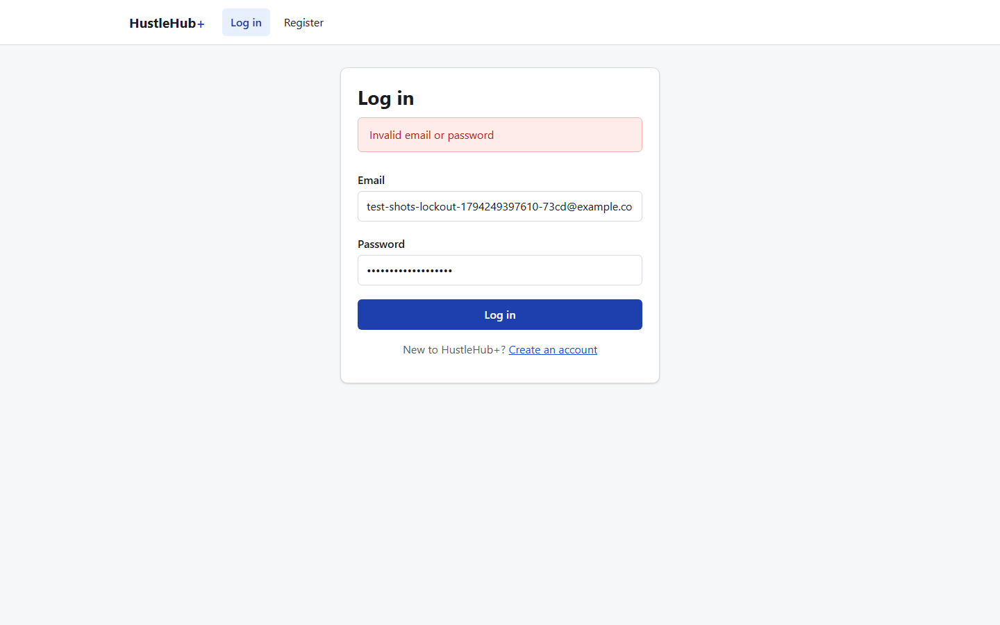

**Files:** `api/src/config/lockout.js`, `api/src/utils/lockout.js` (pure
decision logic and the atomic update), `api/src/utils/accountLockout.js`
(the password check used by login and change-password),
`api/src/controllers/authController.js`, `api/src/models/User.js`.

**Tests:**
- `api/test/lockout.test.js`: 15 unit tests with a fixed clock, covering
  the window, expiry, reset on success, slow guessing and policy overrides.
- `api/test/userModel.test.js`: the fields never reach JSON.
- Newman **Account security**: a throwaway user, five wrong passwords, then
  the **correct** password is still rejected with exactly the same body as
  an unknown email.

**Limitations.** Counters live on the user document, so they are shared by
every API instance (unlike the in-memory rate limits). There is no
CAPTCHA or "unlock by email" step; the lock simply expires.

#### B. Change password and session revocation

**Threat.** A stolen or leaked token stays valid until it expires, and
before this feature nobody could change a password at all. A user who
suspected their account was compromised had no way to lock the attacker
out.

**How it works.**
- **Token versions:** every user has a `tokenVersion` (default 0), and
  every JWT carries it as `tv`. `protect` loads the user's current version
  on each request and rejects any token whose version doesn't match with
  the usual `401`. Tokens issued before this feature have no `tv`, and
  that counts as 0, so existing sessions and existing accounts (including
  the seeded admin) keep working with no migration.
- **`POST /api/auth/change-password`** with `{ currentPassword,
  newPassword }`:
  - `checkExact`, so any other field is a `400`, plus strict `typeof`
    checks.
  - The new password follows the registration rules (8+ characters, a
    number) and must differ from the current one.
  - **At most 72 bytes:** bcrypt silently ignores everything after 72
    bytes. Registration now enforces this too, in bytes, so an emoji counts
    as 4.
  - The current password is checked through the same lockout as login, so
    wrong current passwords count towards locking the account.
  - The new hash is saved with the shared helper and `tokenVersion` is
    incremented in the same update. The response carries a fresh token, so
    this session continues and every other session ends.
  - Rate limited to 5 per 15 minutes per user.
- **Wrong current password is a `400`, not a `401`.** The client treats a
  `401` as "session gone" and logs the user out, so a typo here must not
  return one. A locked account gets the same `400` and the same message.
- **`POST /api/auth/logout-all`** increments `tokenVersion`, so every token,
  the current one included, stops working at once.
- Both routes use `protect` and only ever act on the logged-in user. Both
  are logged (`AUTH_PASSWORD_CHANGED`, `AUTH_LOGOUT_ALL`) and written to
  the audit log.
- **The Account page** (`/account`, in the nav for every role) has the
  change-password form:
  - inline validation and `autocomplete="current-password"` /
    `"new-password"`
  - the stored token is replaced on success
  - clear success and generic error messages
  - the inputs are uncontrolled, so passwords never sit in React state, and
    the form is cleared after a change.

  It also has a **Sign out of all devices** button with a confirmation step;
  afterwards the app returns to the login page.
- This also removes an old limitation: the seeded admin password could
  only be changed by editing the database. Now an admin changes it on the
  Account page like anyone else.

While building this, the login validator also got a `typeof` check. An
array sent as the password used to reach bcrypt and fail with a `500`; it
is now a `400`.

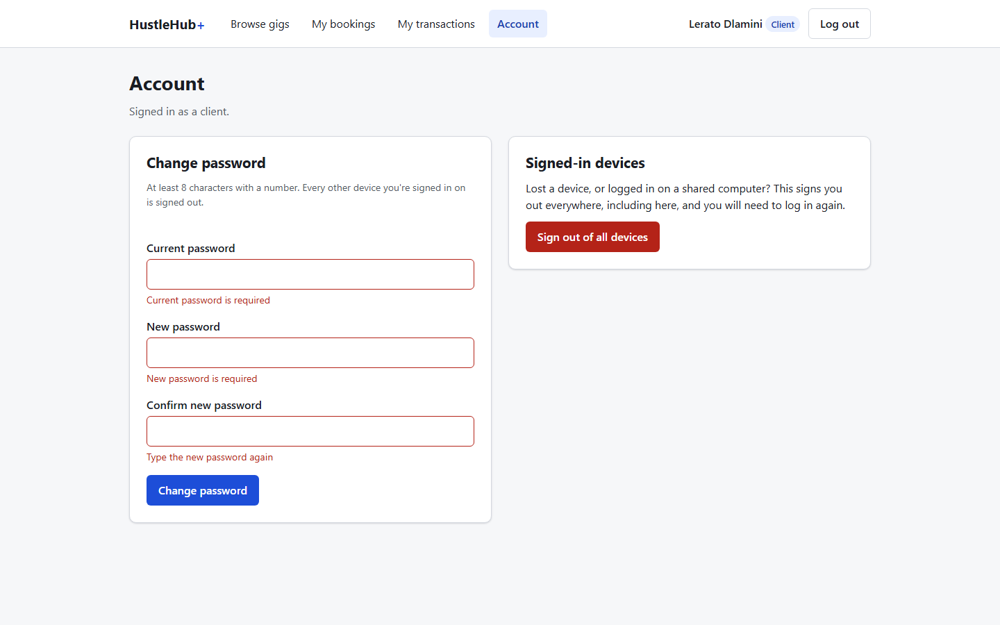

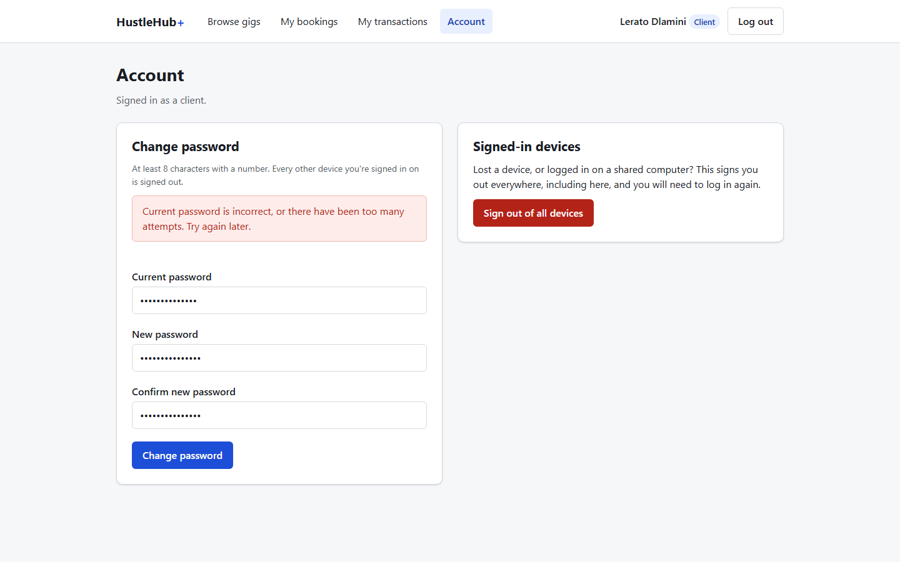

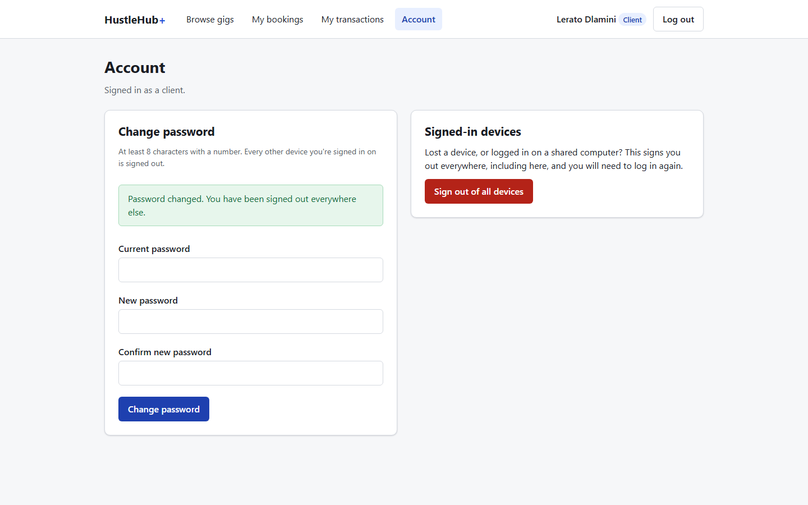

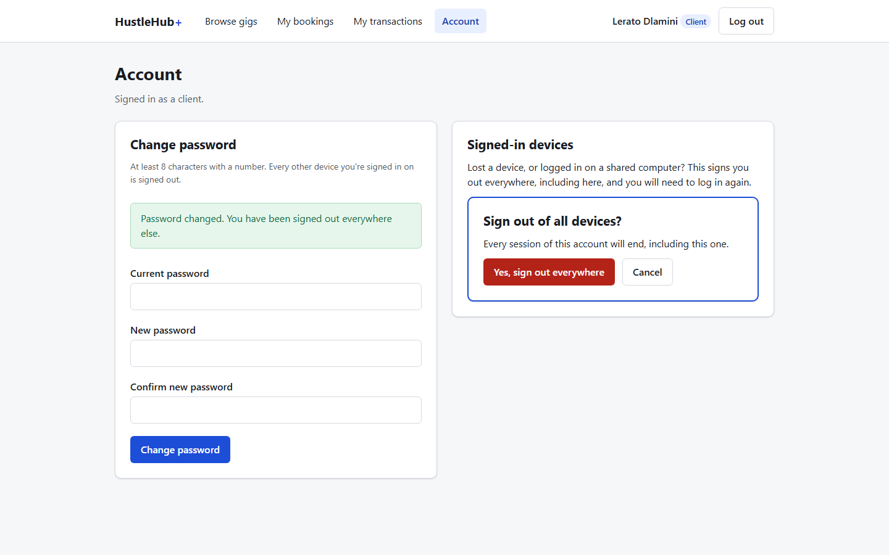

**Files:** `api/src/utils/generateToken.js` (`tv` in the token),
`api/src/middleware/authMiddleware.js`, `api/src/controllers/authController.js`,
`api/src/routes/authRoutes.js`, `api/src/middleware/validators.js`,
`client/src/pages/Account.jsx`, `client/src/context/AuthProvider.jsx`.

**Tests:**
- Unit: `tokenVersion.test.js` (token payload, missing `tv` counts as 0)
  and `authValidators.test.js` (field rules, unknown fields, the 72-byte
  limit counted in bytes).
- Newman **Account security**:
  - every validation failure is a `400`, and no token is a `401`
  - a wrong current password is a `400` and the session survives it
  - after a change, the **old** token gets `401` and the **new** one works
  - the old password no longer logs in and the new one does
  - after logout-all, the current and the earlier tokens are both `401`.
- The smoke test checks the change through the Docker stack.
- Vitest `Account.test.jsx` covers validation, success, the `400` error
  (no logout), the generic `500` message and the confirmation step.

**Limitations.** Every protected request already reads the user from the
database (for the role), so checking the version costs nothing extra. There
is no list of individual sessions, so you can sign out everywhere but not
one specific device. Changing a password doesn't email the user.

#### C. Admin audit log

**Threat.** Without a record, an admin's destructive actions and the
security events on accounts (lockouts, password changes, sign-outs) can't
be reviewed afterwards, so abuse or an account takeover goes unnoticed.
Logs alone are easy to lose and not visible in the app.

**How it works.**
- **Model:** a new `AuditLog` model ([`api/src/models/AuditLog.js`](api/src/models/AuditLog.js))
  stores `actorId`, `actorRole`, `action` (an enum), `targetType`,
  `targetId`, `outcome`, `ip`, `createdAt` and a small whitelisted `meta`
  object (`failedAttempts`, `lockMinutes`, `hadBookings`).
  - `strict: 'throw'` refuses any other field.
  - It never stores passwords, tokens, emails or request bodies.
  - Indexes: `createdAt` descending, and `action` + `createdAt`.
- **Append-only:** there is no route that updates or deletes entries, and
  the model throws on every update, replace and delete operation
  (`updateOne`, `findOneAndUpdate`, `deleteMany`, `bulkWrite`, re-saving a
  loaded entry, ...) before anything reaches the database.
- **What is recorded:** admin gig deletion and deactivation, password
  changed, sign out of all devices, and account locked.
- **Failure handling** ([`api/src/utils/audit.js`](api/src/utils/audit.js)):
  if an audit record can't be written, the failure is logged as an
  `AUDIT_WRITE_FAILED` event (action and error type only, never the entry
  or the raw error message) and the request carries on. It isn't failed or undone, and
  nothing leaks to the client. The admin gig removal doesn't use a
  database transaction, so its audit entry is written straight after the
  removal succeeds.
- **`GET /api/admin/audit-logs`** (admin only, through the existing
  router-level guard):
  - paginated like the transactions list (default 20, max 50)
  - optional `action` filter, validated against the enum
  - `checkExact`, so any other query parameter is a `400`
  - actors shown by name and id only.
- **The admin "Audit log" page** (`/admin/audit-log`) has a table, an
  action filter and paging, in the same style as Users and Transactions.

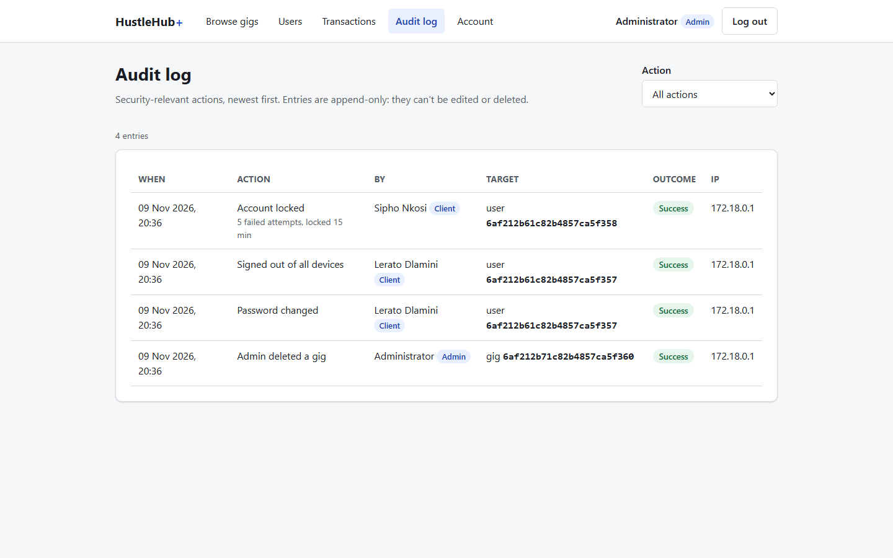

**Files:** `api/src/models/AuditLog.js`, `api/src/utils/audit.js`,
`api/src/controllers/adminController.js`, `api/src/middleware/adminValidators.js`,
`api/src/routes/adminRoutes.js`, `client/src/pages/AdminAuditLog.jsx`.

**Tests:**
- Unit: `auditLog.test.js` (every append-only guard, the whitelist and the
  indexes), `audit.test.js` (a failed write is logged and never throws,
  without the raw error) and `adminValidators.test.js`.
- Newman, with admin credentials, finds each entry:
  - after the password change, the logout-all and the lockout (with
    `{ failedAttempts: 5, lockMinutes: 15 }`)
  - after the admin gig deletion.
- Newman also checks `403` for clients and freelancers, `401` with no token,
  and `400` for a bad `action` or an unknown parameter.
- Vitest: `AdminAuditLog.test.jsx` and `Layout.test.jsx` (who sees which
  link).

**Limitations.** Append-only is enforced by the application. Someone with
direct database access could still change entries; a real deployment
would add a database user without update and delete rights, or ship the
entries to write-once storage. Entries are kept forever, with no retention
policy.

## 9. Final security review

This review maps each threat to the controls we built, where they live,
and the evidence that they work. Every row was checked against the code
and a test, scan or log event on 9 November 2026. OWASP ids are from the
OWASP Top 10 2021. Test names are quoted exactly; Newman requests are in
[`api/postman/`](api/postman/) and the results in
[`docs/test-evidence/`](docs/test-evidence/README.md).

### Threats and controls

| Threat | How the attack would work | Controls implemented | Where it lives | Evidence | Residual risk |
|---|---|---|---|---|---|
| **NoSQL injection** (A03 Injection) | Send `{"email": {"$gt": ""}}` to login so the query matches any user | Global operator stripping (`$` and `.` keys); `typeof` and format checks on every field; strict 24-hex ids; Mongoose schemas with `strict: 'throw'` on the audit log | `api/src/middleware/sanitize.js`, `validators.js`, `gigValidators.js`, `validateObjectId.js` | Newman Security: "Login - Operator in Email (should fail)" and "Browse Gigs - Operator in Query (should fail)" (`400`); `INPUT_SANITIZED` event; Semgrep `p/nodejs` and `p/expressjs`: 0 findings | A new route without validators would rely on the sanitiser alone |
| **Mass assignment** (A04 Insecure Design) | Add `freelancer`, `price`, `role` or `isActive` to a request body to take over a record or set a price | `checkExact` rejects unknown fields on gig, booking, account and query routes; registration and login read only named fields; owner, price and role come from the token and the database | `api/src/middleware/gigValidators.js`, `bookingValidators.js`, `validators.js`; `api/src/controllers/` | Newman: "Create Gig - Unknown Field freelancer (should fail)", "Book Gig - Price in Body (should fail)", "Book Gig - Freelancer in Body (should fail)", "Register - Admin Role (should fail)", "Change Password - Unknown Field (should fail)" | Registration ignores (rather than rejects) unknown fields; harmless, because only named fields are used |
| **Stored XSS** (A03 Injection) | Save a gig title like `` so it runs in every visitor's browser | Text fields trimmed and HTML-escaped before saving; React renders text only; no `dangerouslySetInnerHTML` (`react/no-danger` on); strict CSP with `script-src 'self'` | `api/src/middleware/gigValidators.js`, `validators.js`; `client/src/utils/text.js`; `client/securityHeaders.js` | Vitest: "renders an escaped malicious title as text, with no img element" (GigCard) and "renders an escaped malicious title as plain text, with no img element" (GigDetail) | A future component that renders HTML would need review |
| **Reflected XSS** (A03 Injection) | Put a script in a URL or query so the server echoes it into a page | The API only returns JSON with `nosniff`; the 404 handler uses the path, never the query string; API CSP `default-src 'self'` | `api/src/middleware/errorHandler.js`, `api/src/config/security.js` | Newman Security: "Security Headers"; ZAP baseline: 0 FAIL | None known |
| **DOM XSS** (A03 Injection) | Client JavaScript writes attacker data into the DOM or `eval` | No HTML sinks or `eval` in the client; client CSP without `unsafe-inline` or `unsafe-eval` in nginx, preview and the meta tag | `client/src/`, `client/securityHeaders.js`, `client/nginx.conf` | Vitest: "has a strict CSP with frame-ancestors in the header version", "generates one nginx add_header line per header, with the same values"; Semgrep `p/react` and ESLint: 0 findings | The token in `localStorage` would be readable if XSS ever got in (see below) |
| **Password cracking and weak passwords** (A02 Cryptographic Failures, A07) | Steal the database and crack the hashes, or guess weak passwords | bcryptjs with 10 rounds; at least 8 characters with a number, at most 72 bytes; hashes never selected or returned | `api/src/utils/password.js`, `api/src/middleware/validators.js`, `api/src/models/User.js` | Unit: `authValidators.test.js` (72-byte limit counted in bytes), "toJSON never includes the hash, lockout or session fields"; Newman: "No password hash leaked" | 10 rounds is the bcryptjs default, not the strongest setting; no breached-password check |
| **Brute force, credential stuffing and account enumeration** (A07 Identification and Authentication Failures) | Try many passwords against one account or many, or tell real emails apart by the error or the timing | Login limiter (5 failed per 15 min per IP); account lockout (5 failures in 15 min lock for 15 min, counted atomically); one generic `401` and a dummy bcrypt compare for unknown and locked accounts | `api/src/middleware/rateLimiters.js`, `api/src/utils/accountLockout.js`, `api/src/utils/lockout.js`, `api/src/controllers/authController.js` | Rate limit collection: "Failed Login 6 (rate limited)"; Newman: "Lockout - Correct Password Is Still Rejected (account locked)"; `lockout.test.js` (15 tests); events `AUTH_LOGIN_FAILURE`, `AUTH_LOCKOUT` | Anyone who knows an email can lock that account for 15 minutes; no CAPTCHA or second factor |
| **Token theft, forgery and reuse** (A07) | Forge a token, reuse an old one, or keep using a stolen one after the owner reacts | HS256 signature with `JWT_SECRET` (required, 32+ characters in production); 1 hour expiry; role and token version checked against the database on every request; change password and "sign out of all devices" end older tokens | `api/src/middleware/authMiddleware.js`, `api/src/utils/generateToken.js`, `api/src/config/env.js` | Newman: "Change Password - Old Token Rejected", "Logout All - Other Session Token No Longer Works"; unit: "needs a long JWT_SECRET in production only", `tokenVersion.test.js`; event `ACCESS_DENIED` (`revoked_token`) | A stolen token works until it expires or the user signs out everywhere |
| **Broken access control and IDOR** (A01 Broken Access Control) | A client calls freelancer or admin routes, or a user changes the id in a URL to reach someone else's gig or booking | `protect` on every route except health, register and login; `requireRole`; `requireOwnership` on gig update and delete and on reading a booking; "mine" routes filter by the token's user; admin router guarded at router level; price and role from the database | `api/src/middleware/authMiddleware.js`, `ownership.js`, `api/src/routes/` | Newman RBAC and Gigs: "Admin Users - Client Token (should fail)", "Update Gig - Other Freelancer (should fail)", "Delete Gig - Other Freelancer (should fail)", "Get Booking - Other Freelancer (should fail)", "Income - Client (should fail)"; event `ACCESS_DENIED` (`wrong_role`, `not_owner`) | A new route has to remember its guards; the route audit table makes that reviewable |
| **CSRF and cross-origin abuse** (A01) | A malicious site makes the user's browser call the API | No cookies: the JWT is in the `Authorization` header, which browsers never attach on their own; CORS accepts only `CLIENT_ORIGIN`, with limited methods and headers and no credentials | `api/src/config/security.js` | Newman Security: "CORS - Disallowed Origin" (`403`, no `Access-Control-Allow-Origin`), "CORS - Allowed Origin"; event `ACCESS_DENIED` (`cors_origin`) | None known while the token stays out of cookies |
| **Security misconfiguration** (A05 Security Misconfiguration) | Missing headers, verbose errors, a debug endpoint, or a container running as root with write access | Explicit Helmet config; nginx headers from one shared file and `server_tokens off`; generic error handler; health check returns only `ok`; `X-Powered-By` off; containers non-root, read-only, `cap_drop: ALL`, `no-new-privileges`; API and MongoDB not published; startup checks for required settings | `api/src/config/security.js`, `api/src/middleware/errorHandler.js`, `client/nginx.conf`, `client/securityHeaders.js`, `docker-compose.yml`, `api/src/config/env.js` | Newman: "Security Headers", "Malformed JSON (should fail)"; unit: "GET /api/health says ok and nothing else"; `docker-compose-ps.txt` (uids 1000, 101, 999); hadolint and Trivy config: 0; ZAP: 0 FAIL | The self-signed certificate; the client is served over plain HTTP on localhost in Compose |
| **Sensitive data exposure** (A02, A04) | Read password hashes, tokens or secrets from responses, logs, the repository or images | Hashes and lockout fields never selected or returned; one scrubber redacts secrets in every log record; no stack traces in responses or logs; secrets only in git-ignored `.env` files, excluded by `.dockerignore`; ingest-only Axiom token | `api/src/models/User.js`, `api/src/utils/redact.js`, `api/src/middleware/errorHandler.js`, `.gitignore`, `api/.dockerignore` | Newman: "No password hash leaked"; `redact.test.js` (18 tests); smoke test: "no password hashes or stack traces in the responses"; gitleaks: no leaks in 543 commits; image filesystems searched for the secrets: 0 hits | The JWT in `localStorage` (see the trade-off); logs leave the system for Axiom |
| **Vulnerable and outdated components** (A06 Vulnerable and Outdated Components) | Exploit a known bug in a dependency or base image | Lock files with `npm ci`; `npm audit --omit=dev --audit-level=high` in the pipeline; Trivy fails on fixable HIGH and CRITICAL image vulnerabilities; base images pinned by version and digest; Dependabot weekly with a 7-day cooldown | `api/package-lock.json`, `client/package-lock.json`, `.github/workflows/ci.yml`, `.github/dependabot.yml`, the Dockerfiles | `npm audit --omit=dev`: 0 in both; Trivy: 0 fixable HIGH or CRITICAL in the api, client and certs images | Dependabot ignores major versions, so those are manual decisions; a future advisory may need a major upgrade |
| **Logging and monitoring failures** (A09 Security Logging and Monitoring Failures) | An attack goes unnoticed because nothing is recorded, or logs are lost or leak secrets | A structured event for every security action with request ids; redaction; shipping to Axiom with batching, retries and drop counts; ready-made queries and monitors; an append-only audit log in the app | `api/src/utils/logger.js`, `logShipper.js`, `logEvents.js`, `audit.js`, `api/src/models/AuditLog.js` | `logger.test.js`, `logShipper.test.js`, `auditLog.test.js`; `docs/logging-evidence/` (all 25 event names, live run accepted by Axiom with 0 failed); Newman (with admin credentials): "Audit Log - Admin Sees The Lockout (skipped without admin credentials)" | Shipping is best effort; monitors must be created in Axiom; audit log append-only at application level only |
| **Denial of service and ReDoS** (no single 2021 id) | Flood the API, send huge bodies or pages, or a string that makes a regex backtrack for seconds | General limit 100 per 15 min per IP plus the route limits; 10kb body limit (16k in nginx); `limit` at most 50, `page` at most 1000, search at most 50 characters; regexes without nested quantifiers (`security/detect-unsafe-regex`); the log scrubber cuts strings before matching | `api/src/app.js`, `api/src/middleware/rateLimiters.js`, `gigValidators.js`, `client/nginx.conf`, `api/src/utils/redact.js` | Newman: "Oversized Body (should fail)" (`413`); rate limit collection: "Booking 11 (rate limited)"; unit: "the decimals check is fast even on a long input" | The in-memory limiter is per API instance; no CDN or WAF in front |
| **Business logic and data integrity** (A04 Insecure Design) | Pay less than the price, book an inactive gig, leave a booking without a payment record, or create rounding drift | Price and parties taken from the database; booking and transaction in one MongoDB transaction; one transaction per booking (unique index); inactive gigs refused; money rounded to 2 decimals, tax worked out in whole cents | `api/src/controllers/bookingController.js`, `api/src/models/Transaction.js`, `api/src/utils/money.js`, `api/src/utils/taxCalculator.js` | Newman Bookings: "Book Gig - Price in Body (should fail)", "Book Gig - Inactive Gig (should fail)", "Get Booking - Price Unchanged After Gig Edit"; unit: "roundMoney removes floating point noise", `taxCalculator.test.js` | Payments are simulated; there is no refund flow |
| **Supply chain and CI** (A08 Software and Data Integrity Failures) | A compromised action, tool image or package release changes what the pipeline runs, or a secret leaks into the repository | Every action pinned to a full commit SHA; tool images pinned by digest; `permissions: contents: read`; `persist-credentials: false`; no `pull_request_target`; no repository secrets (generated per job and masked); gitleaks over the full history; actionlint and zizmor; Dependabot cooldown | `.github/workflows/ci.yml`, `.github/scripts/make-ci-env.sh`, `.github/dependabot.yml` | [`local-checks.txt`](docs/pipeline-evidence/local-checks.txt): actionlint 0, zizmor (auditor persona) 0; gitleaks: no leaks | The remote pipeline can't run while the account is billing locked, so it was verified locally |
| **Transport security** (A02 Cryptographic Failures) | Read or change traffic between the components | API over HTTPS with HSTS; nginx verifies the API certificate (`proxy_ssl_verify on`) and sends a fixed `Host`; Axiom over HTTPS only; Atlas over TLS | `api/src/server.js`, `client/nginx.conf`, `api/src/utils/logShipper.js` | Smoke test through nginx (fails if verification fails); unit: "https is required; plain http only to loopback in a test run" | Self-signed certificate; browser to nginx is plain HTTP on localhost; MongoDB in Compose has no TLS or authentication (internal network only) |

### Detection scenarios

What each attack leaves behind in the logs (all searchable in Axiom with
the queries in [`axiom-queries.md`](docs/logging-evidence/axiom-queries.md))
and in the in-app audit log:

| Attack | Log events (in order) | Audit log entry | Alert |
|---|---|---|---|
| Brute force on one account | `AUTH_LOGIN_FAILURE` (`reason: bad_credentials`, masked email, user id, IP) for each of the 5 failures, and `AUTH_LOCKOUT` (`failedAttempts: 5`, `lockMinutes: 15`) with the 5th; later tries give `AUTH_LOGIN_FAILURE` (`reason: locked`) or, from one IP, `RATE_LIMIT_EXCEEDED` (`limiter: login`) | `account_locked` with `{ failedAttempts: 5, lockMinutes: 15 }` | Monitor "Brute force on login" (more than 20 failures in 5 minutes) |
| Privilege escalation attempt | Registering as admin: `VALIDATION_FAILED` (`fields: ["role"]`). A client calling `/api/admin/users`: `ACCESS_DENIED` (`reason: wrong_role`, `status: 403`, `role: client`, route). Editing another freelancer's gig: `ACCESS_DENIED` (`reason: not_owner`, `route: /api/gigs/:id`, resource id) | None (nothing was changed) | Query 3 (403s by route) |
| Rate limit abuse (booking spam) | `BOOKING_CREATED` and `TRANSACTION_CREATED` for the first 10, then `RATE_LIMIT_EXCEEDED` (`limiter: booking`, route `/api/bookings`, user id) and an `HTTP_REQUEST` with status 429 | None | Monitor "Lockouts or rate limiting" |
| Token reuse after a password change | `AUTH_PASSWORD_CHANGED` (user id, IP), then each use of an old token gives `ACCESS_DENIED` (`reason: revoked_token`, `status: 401`, route, IP). The user id isn't on that event, because the token is not trusted at that point | `password_changed` (actor, IP) | Query 3 without the 403 filter |

The brute force and access denial events were triggered in the local mock
check and appear in
[`sample-events.jsonl`](docs/logging-evidence/sample-events.jsonl). The
booking limit and token revocation are exercised by the Newman runs (the
rate limit collection and the Account security folder), which log to the
console only, because test runs never ship to Axiom.

### Effectiveness of the controls

These are the real results of the runs on 9 November 2026. The Newman run
against the Docker stack is from earlier the same day, before this
documentation-only update, and also passed with 131 requests and 246
assertions.

| Check | Result | What it shows |
|---|---|---|
| Newman main collection, with admin | **131 requests, 246 assertions, 0 failed**. Security folder 15 requests and 31 assertions, Account security 36 and 69, RBAC 8 and 16 | Every access control, validation, header, CORS, lockout, revocation and audit log rule holds when the API is called directly |
| Newman rate limit collection, strict limits | **20 requests, 26 assertions, 0 failed** | The 6th failed login and the 11th booking get `429` with `Retry-After` and a message whose seconds match |
| Smoke test through nginx | **15 checks passed** | The CSP header, TLS to the API, auth, RBAC and token revocation work in the containers |
| Static analysis, before and after | Baseline **126 findings** (ESLint api 17, client 103, Semgrep 6) to **0**. Re-run now: ESLint 0, Semgrep 0 (152 rules, 216 files) | Two real configuration weaknesses (a forwarded Host header in nginx, Dependabot without a cooldown) and several unsafe patterns were fixed, not suppressed. See [Static code analysis](#12-static-code-analysis) |
| Trivy | api, client and certs images: **0** fixable HIGH or CRITICAL vulnerabilities. Dockerfiles: **0** misconfigurations | No known fixable vulnerability ships in the images |
| gitleaks | **No leaks** in 543 commits (full history, all branches) | No secret was ever committed |
| OWASP ZAP baseline | **0 FAIL, 3 WARN, 65 PASS** | Headers and information leak rules all pass from the outside. The warnings are informational and don't fail the scan: "Suspicious Comments" (a word ZAP flags in the minified JavaScript bundle), "Storable and Cacheable Content" (public static files and pages with no private data) and "Modern Web Application" |
| npm audit (what ships) | **0** vulnerabilities in the api and the client | No known vulnerable production dependency |
| Logging checks | Mock check: all 25 event names arrived, 90 records, 0 dropped. Live check: Axiom accepted 39 records (HTTP 200, 0 failed) | The detection scenarios above are actually recorded and shipped |

The raw outputs are in [`docs/test-evidence/`](docs/test-evidence/README.md),
[`docs/pipeline-evidence/`](docs/pipeline-evidence/README.md),
[`docs/static-analysis/`](docs/static-analysis/README.md) and
[`docs/logging-evidence/`](docs/logging-evidence/README.md).

### Residual risks and accepted limitations

- **JWT in `localStorage`.** Any successful XSS could read the token. The
  CSP, escaping, short expiry and revocation reduce the risk; an
  `httpOnly` cookie with CSRF protection would be the stronger choice for
  a real deployment.
- **In-memory rate limiter.** Counters live in each API process. They
  reset on restart and are not shared between several API instances; a
  shared store such as Redis would be needed to scale out. (The lockout
  counters are on the user document, so they are shared.)
- **MongoDB without authentication inside Compose.** It is reachable only
  on the internal Compose network and never published. A real deployment
  would enable authentication and TLS, or use Atlas.
- **Self-signed certificate and plain HTTP on localhost.** The API
  certificate is self-signed, and the browser talks to nginx over HTTP on
  `localhost:5173`. A deployment needs a real certificate on nginx and
  HTTPS for the browser.
- **No two-factor authentication**, no CAPTCHA and no email to the user
  after a password change or lockout.
- **Logs are sent to a third party.** Axiom (hosted in the US) receives
  user ids, masked emails, IP addresses and paths for 30 days. See the
  POPIA note in [Logging and monitoring](#14-logging-and-monitoring).
- **Dependabot ignores major versions** for npm and Docker images, so
  major upgrades are a manual decision.
- **The remote CI pipeline can't run.** GitHub refuses to start any job
  while the account is locked for a billing issue, so every job was run
  locally with the same commands instead (see
  [Pipeline status and the billing lock](#pipeline-status-and-the-billing-lock)).
- **Audit log append-only at application level.** Someone with direct
  database access could still change entries.
- **Payments are simulated.** No payment provider is involved and no money
  moves.

## 10. Testing

Every suite was run on 9 November 2026 and passed. The raw output is in
[`docs/test-evidence/`](docs/test-evidence/README.md).

| Suite | What it covers | Result | How to run it | Evidence |
|---|---|---|---|---|
| API unit tests (Node's test runner) | Tax calculator, tax years and config, money rounding, startup settings, trust proxy and rate limit buckets, health check, gig validators, account lockout, token versions, auth and admin validators, audit log guards and helper, the log scrubber, the logger and event catalogue, request ids and the access log, and the log shipper against a local mock server. No database or secrets needed | **191 tests, 21 files, 0 failed** | `cd api; npm test` | [`api-unit-results.txt`](docs/test-evidence/api-unit-results.txt) |
| Main Postman collection (Newman) | Health, auth, RBAC, gigs, bookings, income and tax estimate, account security (lockout, change password, sign out everywhere, audit log) and security (headers, injection, CORS, body limits, admin delete) | **131 requests, 246 assertions, 0 failed** with the admin credentials (119 requests and 213 assertions without them, when the 12 admin-only requests are skipped) | API on `npm run start:test`, then Newman (below) | [`newman-main-results.txt`](docs/test-evidence/newman-main-results.txt) |
| Rate limit collection (Newman) | The 6th failed login and the 11th booking get `429` with `Retry-After` and a matching message | **20 requests, 26 assertions, 0 failed** | API freshly started with `npm run start:test:strict`, then Newman | [`newman-rate-limits-results.txt`](docs/test-evidence/newman-rate-limits-results.txt) |
| Frontend (Vitest and React Testing Library) | Rendering and user interaction for every main page, the API client, XSS rendering, the tax dashboard and chart, the Account page, the audit log page and the security header consistency | **110 tests, 21 files, 0 failed** | `cd client; npm run test:run` | [`vitest-results.txt`](docs/test-evidence/vitest-results.txt) |
| Main collection against Docker | The same collection against the API container, with bookings using the Compose MongoDB replica set | **131 requests, 246 assertions, 0 failed** | See [Docker](#13-docker) | [`docker-newman-results.txt`](docs/test-evidence/docker-newman-results.txt) |
| Docker smoke test | The page and its CSP, `/api/health` through nginx, register, login, a protected route with and without a token, an admin route as a client, and a password change that ends the old token | **15 checks passed** | `node docker/smoke-test.mjs` (stack running) | [`docker-smoke-test-results.txt`](docs/test-evidence/docker-smoke-test-results.txt) |
| Lint and static analysis | ESLint (with the security plugin) in both packages, Semgrep with 152 rules | **0 problems, 0 findings** | `npm run lint` in `api/` and `client/`, `node .semgrep/run.mjs` | [Static code analysis](#12-static-code-analysis) |
| Pipeline checks run locally | actionlint, zizmor, hadolint, `docker compose config`, npm audit, gitleaks, Trivy, ZAP baseline | **all clean** | [CI/CD pipeline](#11-cicd-pipeline) | [`docs/pipeline-evidence/`](docs/pipeline-evidence/README.md) |
| Client production build | `npm run build`, and the CSP meta tag is in the built `index.html` | **passes** | `cd client; npm run build` | |

### Running the Newman collections

The main collection registers and logs in far more often than the strict
limits allow, so it runs against the API with relaxed limits. The limits
themselves are proven by the second collection against the strict ones.
Both start commands are test runs, so nothing is shipped to Axiom.

```bash
cd api

# 1. Main collection, relaxed limits
npm run start:test          # terminal 1 (refuses to run in production)
npx newman run postman/HustleHub_API.postman_collection.json --insecure \
  --env-var admin_email=<ADMIN_EMAIL> --env-var admin_password=<ADMIN_PASSWORD>   # terminal 2

# 2. Rate limit collection, strict limits (stop start:test first)
npm run start:test:strict   # terminal 1
npx newman run postman/HustleHub_RateLimits.postman_collection.json --insecure    # terminal 2

# afterwards
npm run clean:test
```

- The admin credentials are passed as variables and never stored in the
  collection. Without them the 12 admin-only requests are skipped cleanly.
- In PowerShell, put each Newman command on one line.
- Rate limit counters live in memory, so restart the API before running
  the rate limit collection again.
- Every run registers users with a fresh `test-...@example.com` email, so
  the collections can be run repeatedly. `npm run clean:test` removes them
  with their gigs, bookings and transactions.
- Both collections can be imported into Postman (turn off "SSL
  certificate verification" under Settings, General).

### What the main collection checks

| Folder | Requests / assertions | What it checks |
|---|---|---|
| Health and Auth | 10 / 19 | Health check; registration (token returned, no password hash), duplicate email `409`, invalid input `400`; login success; wrong password and unknown email get the same `401`; protected route with no, invalid and valid token |
| RBAC | 8 / 16 | `/api/admin/users`: no token `401`, client and freelancer `403`; registering as admin `400`; the admin gets `200` with no password hashes |
| Gigs | 22 / 33 | Create as freelancer (owner from the token), client `403`, no token `401`; negative price, empty title and an unknown `freelancer` field `400`; browsing shows names only; regex characters in `q` are plain text; malformed id `400`, unknown id `404`; only the owner can update or delete |
| Bookings | 26 / 43 | Booking price and parties come from the gig and the token, with a payment confirmation; `price`, `freelancer` or `status` in the body `400`; freelancer `403`; malformed, unknown and inactive gigs; both parties see the booking and the other freelancer gets `403`; the price stays as booked after a gig edit |
| Income | 14 / 35 | Income for the right freelancer only; the tax estimate (values, `403` for client and admin, `401`, `400` for a bad or unsupported `taxYear` or an unknown parameter); admin transactions |
| Account security | 36 / 69 | Lockout (5 wrong passwords, then the correct one is rejected with the same body as an unknown email); change password (validation, wrong current password is `400` and the session survives, old token `401`, new token works, old password no longer logs in); sign out everywhere (current and other tokens `401`); audit log access and the entries for each action |
| Security | 15 / 31 | CSP, nosniff, no-referrer and HSTS headers, no `X-Powered-By`; operator objects in the body and query `400`; a disallowed origin `403` with no CORS header; malformed JSON `400` and an oversized body `413` with no stack trace; admin gig delete (`403` for others) and its audit entry |

### Frontend tests

Vitest with React Testing Library (jsdom). Tests sit next to the code
(`*.test.js`, `*.test.jsx`). No test touches the network: the API modules
or `fetch` are mocked, and the setup file fails any unmocked `fetch`.
`npm test` runs in watch mode.

| Area | Files (tests) | What is checked |
|---|---|---|
| API client | `client.test.js` (10) | Bearer header, unwrapping `{ success, data }`, the server's error message, a generic message on network failure, the 429 message, logout on `401` (not on a failed login), absolute URLs refused |
| Auth pages | `Register.test.jsx` (4), `Login.test.jsx` (4), `ProtectedRoute.test.jsx` (4), `Layout.test.jsx` (5) | Inline errors, only client and freelancer offered, the generic login error, the 429 message, redirects and "Not allowed", who sees which nav link |
| Gigs and booking | `Gigs.test.jsx` (6), `GigCard.test.jsx` (2), `GigDetail.test.jsx` (5), `BookingPanel.test.jsx` (5), `GigForm.test.jsx` (3), `GigEditor.test.jsx` (3), `MyGigs.test.jsx` (5) | Loading, empty and error states; a debounced search; the XSS title rendered as text; what each role sees; the booking confirmation, a double click booking once, the reference; form limits; edits without double escaping; delete or deactivate |
| Income and tax | `Income.test.jsx` (7), `MonthlyIncomeChart.test.jsx` (5) | Summary cards, the bracket breakdown and assumptions, switching the tax year, loading, empty and error states, the per-booking list, only a SARS source link; the chart's accessible summary, hidden table and no inline styles |
| Account and admin | `Account.test.jsx` (8), `AdminAuditLog.test.jsx` (5), `AdminUsers.test.jsx` (2) | Change password validation and success, the `400` that doesn't log out, the generic `500` message, the sign-out confirmation; audit entries shown readably, the action filter, an unknown action ignored, empty and error states; no password field on the Users page |
| Utilities and headers | `format.test.js` (8), `text.test.js` (4), `validation.test.js` (7), `securityHeaders.test.js` (8) | Rand and date formatting, entity decoding, validation rules that mirror the API, and nginx, preview and the shared header file agreeing |

## 11. CI/CD pipeline

The GitHub Actions workflow [`.github/workflows/ci.yml`](.github/workflows/ci.yml)
(named **CI**) is set to run on every push to `main`, every pull request
and every manual run (**Run workflow**). It tests the code, runs several
kinds of security checks, builds and starts the **whole stack** in Docker,
tests it end to end, and fails if anything fails.

**Current status:** GitHub doesn't start any job for this repository,
because the account is locked for a billing issue. Every job was therefore
run locally with the same commands. Read
[Pipeline status and the billing lock](#pipeline-status-and-the-billing-lock)
first.

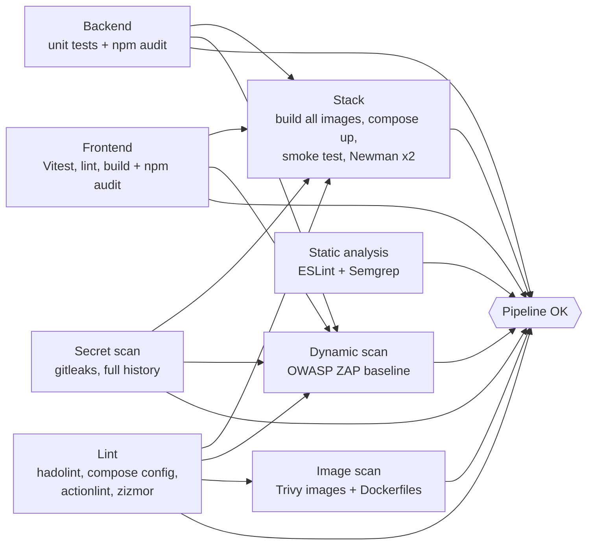

The four fast jobs and the static analysis job run in parallel. The stack
and the ZAP scan only start when the four fast jobs pass, so nothing is
deployed or scanned on top of broken code. The image scan starts as soon as
the Dockerfiles have passed lint.

### What each job checks, and why it matters for security

| Job | What it does | Why |
|---|---|---|
| **Backend - unit tests and npm audit** | `npm ci`, `npm test` (191 unit tests: tax calculator, startup settings check, trust proxy and rate limit buckets, health check, gig price validation, account lockout, token versions, audit log guards, log redaction, the structured logger, request ids and the cloud log shipper), `npm audit --omit=dev --audit-level=high` | Proves the money and security logic behaves, and that no known high or critical vulnerability ships in a production dependency |
| **Frontend - tests, build and npm audit** | `npm ci`, `npm run test:run` (110 Vitest tests, including the CSP and security header consistency test), `npm run lint`, `npm run build` (and checks the CSP meta tag is in the build), `npm audit --omit=dev --audit-level=high` | Same for the React app; a build without its CSP fails |
| **Secret scan - gitleaks (full history)** | gitleaks over **every commit** (`fetch-depth: 0`), not just the latest | A secret committed and later deleted is still in history; this catches it. No allowlist: the history scans clean |
| **Lint - Dockerfiles, Compose and workflows** | hadolint on all three Dockerfiles; `docker compose config` on both Compose files, plus a check that Compose **refuses** to run without `JWT_SECRET`; actionlint and zizmor on this workflow | Catches insecure or broken container and pipeline configuration before anything runs. zizmor is a security audit of the workflow itself (injection, credential persistence, unpinned actions) |
| **Stack - build, smoke test and Newman** | Generates random credentials, builds the certs, api and client images, `docker compose up -d --build --wait`, runs `docker/smoke-test.mjs`, the **rate limit** collection against the strict limits, seeds the admin, switches to the test override and runs the **main** collection (with the admin tests) | Proves the **entire stack** builds, starts healthy and enforces auth, RBAC, ownership, validation, rate limits, CORS and headers end to end |
| **Image scan - Trivy** | Trivy on the api, client and certs images (fails on HIGH/CRITICAL vulnerabilities that have a fix, `--ignore-unfixed`), and Trivy's Dockerfile misconfiguration scan | Known-vulnerable OS packages or libraries in the images, or risky Dockerfile patterns (root user, no healthcheck, ...), fail the build. There is no `.trivyignore` |
| **Dynamic scan - OWASP ZAP baseline** | Starts the stack and runs the ZAP baseline scan (spider plus passive scan) against `http://localhost:5173` | Tests the running app from the outside like an attacker would: missing or broken security headers, information leaks, cross-domain problems |
| **Static analysis - ESLint and Semgrep** | ESLint with eslint-plugin-security on `api/` and `client/` (`--max-warnings 0`), Semgrep with seven rule packs (`--error`). Uploads JSON and SARIF | Finds insecure code patterns in the source before it runs. See [Static code analysis](#12-static-code-analysis) |
| **Pipeline OK** | Runs last, always, and fails unless **every** job above succeeded | One check to require in branch protection |

The ZAP rules live in [`.zap/rules.tsv`](.zap/rules.tsv). Missing or
broken security headers (CSP, anti-clickjacking, nosniff,
Permissions-Policy, site isolation), information leaks (server version,
`X-Powered-By`, debug errors, source code), cross-domain problems and
vulnerable JavaScript libraries are set to **FAIL**. Everything else is
reported as a warning in the report but doesn't fail the job. One rule is
ignored: *ZAP is Out of Date* (10116), because the image is pinned on
purpose and updated by Dependabot. The first scan found two real problems,
both fixed rather than suppressed: no `Permissions-Policy` header and
missing cross-origin isolation headers. All of them are now sent from
`client/securityHeaders.js`, and nginx's `/healthz` sends them too. The
scan takes about a minute.

### How the pipeline itself is secured

- The workflow token is read-only (`permissions: contents: read`), and
  `actions/checkout` runs with `persist-credentials: false`, so no step can
  push or reuse the token.
- Every action is pinned to a full commit SHA, with the version in a
  comment, and every tool image (gitleaks, hadolint, actionlint, zizmor,
  Trivy, ZAP) to a tag **and** a digest, so a moved tag can't change what
  runs.
- It triggers on `push`, `pull_request` and `workflow_dispatch` only (never
  `pull_request_target`). Branch names and PR titles are never put into a
  script. A newer run on the same branch cancels the older one.
- It needs **no repository secrets**.
  [`.github/scripts/make-ci-env.sh`](.github/scripts/make-ci-env.sh)
  generates a random `JWT_SECRET` (96 characters), admin email and admin
  password (35 characters) in each job, masks them with `::add-mask::`, and
  writes them to a job-local `.env` that disappears with the runner.
- Newman's full JSON report contains request bodies and the generated
  admin password, so it is never uploaded. Only the JUnit files and a slim
  JSON (request names, status codes, assertion results) are.

### How a failure is enforced

- Every `run:` step uses bash with `-e -o pipefail`, so a failing command
  fails the step even when its output is piped through `tee`.
- There is no `continue-on-error` and no `|| true` anywhere.
- Unit tests, Vitest, Newman and smoke-test failures exit non-zero.
  `npm audit --audit-level=high`, gitleaks, Trivy (`--exit-code 1`),
  hadolint, actionlint, zizmor and ZAP FAIL rules all do the same.
- `Pipeline OK` needs every job and checks each one's result explicitly,
  so a failed, cancelled or skipped job turns it red.
- This was tested locally (see the next subsection for the details).

### Where the results appear when the pipeline runs

- **Actions** tab → the run → **Summary**. Each job writes its key results
  there: unit test and Vitest counts, Newman requests and assertions for
  both collections, the gitleaks result, the Trivy result and the ZAP
  FAIL/WARN counts. `Pipeline OK` adds a table of every job's result.
- **Artifacts** at the bottom of the run summary: `newman-results` (JUnit
  and slim JSON for both collections, plus the smoke test output),
  `trivy-results` (one table per image plus the Dockerfile scan) and
  `zap-report` (HTML, JSON and Markdown report). They're kept for 14 days.
- If the stack job fails, it prints every container's log before it tears
  the stack down. Teardown (`docker compose down -v`) always runs.
- Until the billing lock is cleared there is no remote run. The local
  results are in [`docs/pipeline-evidence/`](docs/pipeline-evidence/README.md)
  and [`docs/test-evidence/`](docs/test-evidence/README.md).

### Dependabot

[`.github/dependabot.yml`](.github/dependabot.yml) opens weekly update
pull requests for the npm packages in `api/` and `client/`, the pinned
actions, the three Dockerfiles' base images and the mongo image in
Compose, with a 7-day cooldown after each release. Major versions are
ignored for npm and Docker. Each pull request is meant to pass this
pipeline before it is merged; while the billing lock is in place, that has
to be checked locally.

### Running every job locally

From the repo root, with Docker running. These are the commands the jobs
run:

```bash
# Backend
cd api && npm ci && npm test && npm audit --omit=dev --audit-level=high && cd ..

# Frontend
cd client && npm ci && npm run test:run && npm run lint && npm run build && npm audit --omit=dev --audit-level=high && cd ..

# Secret scan (full history)
docker run --rm -v "$PWD:/repo" zricethezav/gitleaks:v8.30.1 git --no-banner --redact --verbose --exit-code 1 /repo

# Lint
for f in api/Dockerfile client/Dockerfile docker/certs/Dockerfile; do docker run --rm -i hadolint/hadolint:v2.15.1 hadolint - < "$f"; done
JWT_SECRET=x docker compose config --quiet
JWT_SECRET=x docker compose -f docker-compose.yml -f docker-compose.test.yml config --quiet
docker run --rm -v "$PWD:/repo" --workdir /repo rhysd/actionlint:1.7.12 -color
docker run --rm -v "$PWD:/repo:ro" ghcr.io/zizmorcore/zizmor:1.32.0 --offline /repo/.github/workflows

# Image scan (after docker compose build)
for i in hustlehub-api:local hustlehub-client:local hustlehub-certs:local; do
  docker run --rm -v /var/run/docker.sock:/var/run/docker.sock aquasec/trivy:0.76.2 image --scanners vuln --severity HIGH,CRITICAL --ignore-unfixed --exit-code 1 "$i"
done
docker run --rm -v "$PWD:/repo:ro" aquasec/trivy:0.76.2 config --misconfig-scanners dockerfile --exit-code 1 /repo
# on Windows, add --timeout 20m --skip-dirs "**/node_modules" (the mount is slow)

# Stack (uses your root .env; see section 4 B). The empty LOG_SHIPPING_* values
# keep this test traffic out of Axiom (the pipeline has no Axiom settings at all)
LOG_SHIPPING_URL= LOG_SHIPPING_TOKEN= docker compose up -d --build --wait
node docker/smoke-test.mjs
npx newman run api/postman/HustleHub_RateLimits.postman_collection.json --env-var base_url=http://localhost:5173
docker compose run --rm seed
docker compose -f docker-compose.yml -f docker-compose.test.yml up -d --wait
npx newman run api/postman/HustleHub_API.postman_collection.json --insecure --env-var base_url=https://localhost:5000 \
  --env-var admin_email=<ADMIN_EMAIL> --env-var admin_password=<ADMIN_PASSWORD>

# Static analysis (see "Static code analysis" below)
cd api && npm run lint && cd ..
cd client && npm run lint && cd ..
node .semgrep/run.mjs

# Dynamic scan (stack running; joins the Compose network, so it works the same on Windows)
mkdir -p zap-report && cp .zap/rules.tsv zap-report/
docker run --rm --network hustlehub_default -v "$PWD/zap-report:/zap/wrk:rw" zaproxy/zap-stable:2.17.0 \
  zap-baseline.py -t http://client:8080 -c rules.tsv -I -r zap-report.html

docker compose -f docker-compose.yml -f docker-compose.test.yml down -v
```

In PowerShell, use `${PWD}` instead of `$PWD`, run the `for` loops one
image or file at a time, and put each command on one line. Git Bash on
Windows needs `MSYS_NO_PATHCONV=1` in front of the `docker run` commands
that mount a folder. The rate limit collection runs through the client
(`http://localhost:5173`), exactly like the pipeline. It needs freshly
started counters, so run it before anything else after `up`.

<!-- BEGIN: Pipeline status and the billing lock. Remove or edit this whole block once the pipeline runs on GitHub. -->

### Pipeline status and the billing lock

**What happens on GitHub.** GitHub refuses to start any job for this
repository, because the account is locked due to a billing issue. Every
job shows GitHub's own message:

> The job was not started because your account is locked due to a billing issue.

So every run shows **0 steps**, and every job is marked failed (the jobs
that should have started) or skipped (the jobs that wait for them). This is an account setting on
GitHub. It is not a failure of the code or of the workflow: no step of
the workflow ever ran. The status badge at the top of this README shows a
failing or empty state for the same reason.


**How the pipeline was verified instead.** Every job was run locally with
the exact same commands the workflow runs (listed in
[Running every job locally](#running-every-job-locally)), on 9 November
2026:

| Job | Local result |
|---|---|
| Backend: unit tests and npm audit | 191 tests passed; `npm audit --omit=dev --audit-level=high`: 0 vulnerabilities |
| Frontend: tests, build and npm audit | 110 tests passed; lint clean; build passes with the CSP meta tag; npm audit: 0 vulnerabilities |
| Secret scan: gitleaks | No leaks, full history |
| Lint: Dockerfiles, Compose and workflows | hadolint clean on all three Dockerfiles; both Compose files valid, and Compose refuses to run without `JWT_SECRET`; actionlint and zizmor (strictest auditor persona): no findings |
| Stack: build, smoke test and Newman | All images build and the stack is healthy; smoke test 15 checks; rate limit collection 20 requests and 26 assertions; main collection against the test override 131 requests and 246 assertions; 0 failed |
| Image scan: Trivy | 0 fixable HIGH or CRITICAL in the api, client and certs images; 0 Dockerfile misconfigurations |
| Dynamic scan: OWASP ZAP baseline | 0 FAIL, 3 WARN (informational), 65 PASS |
| Static analysis: ESLint and Semgrep | 0 problems, 0 findings (152 rules) |

The results are saved in [`docs/pipeline-evidence/`](docs/pipeline-evidence/README.md)
(lint, config, audit, gitleaks, Trivy and ZAP output) and
[`docs/test-evidence/`](docs/test-evidence/README.md) (every test run).

**The workflow itself was checked** with actionlint (syntax, expressions
and shell scripts in `run:` steps) and zizmor (a security audit of the
workflow: script injection, credential persistence, unpinned actions,
over-broad permissions), both with no findings.

**It was proven to fail closed.** Each of these was broken on purpose,
run with the job's command, shown to exit 1 (which fails the step and
therefore the job and Pipeline OK), and then restored without being
committed:

- a unit test assertion (`npm test` exits 1)
- the api lock file, rolled back to a version with a known body-parser
  advisory (`npm audit --omit=dev --audit-level=high` exits 1)
- the health check response (a Newman assertion fails, so Newman exits 1)
- ZAP pointed at a page without the security headers (FAIL rules, exit 1)
- an `eval` of `req.query` and a hard-coded JWT secret added to
  `api/src/app.js` (`npm run lint` exits 1; Semgrep exits 1 with 3
  findings)

On top of that, every `run:` step uses `bash -e -o pipefail`, there is no
`continue-on-error` and no `|| true`, and Pipeline OK checks every job's
result explicitly, so a failed, cancelled or skipped job fails it.

**How a reviewer can check it.**

1. Run the commands in [Running every job locally](#running-every-job-locally)
   and compare with the evidence files.
2. Once the billing lock is cleared: **Actions**, then **CI**, then **Run
   workflow** on `main`. Each job writes its results to the run's
   **Summary**, and Pipeline OK adds a table of every job's result.

<!-- END: Pipeline status and the billing lock -->

## 12. Static code analysis

Two static analysis tools read the source code (without running it) and
look for insecure patterns. Both run in the pipeline's **Static analysis -
ESLint and Semgrep** job and fail it on **any** finding. Both can be run
locally with the exact same configuration.

### The tools and why they were chosen

| Tool | What it checks | Configuration |
|---|---|---|
| **ESLint 9** with [eslint-plugin-security](https://github.com/eslint-community/eslint-plugin-security) | Runs on every `.js`/`.jsx` file in `api/` and `client/`, including tests and scripts. `@eslint/js` recommended rules catch bugs (undefined or unused variables, unreachable code). eslint-plugin-security catches Node security smells: `eval` with an expression, regular expressions that can backtrack catastrophically (ReDoS), `new RegExp` built from variables, file paths and `require` built from variables, timing-unsafe comparisons, `child_process` with variables, and dynamic object keys that could reach the prototype ("object injection"). In the client, eslint-plugin-react (including `react/no-danger` and `react/jsx-no-target-blank`) and eslint-plugin-react-hooks are also on | [`api/eslint.config.js`](api/eslint.config.js), [`client/eslint.config.js`](client/eslint.config.js) (flat config). `npm run lint` = `eslint . --max-warnings 0` |
| **Semgrep Community Edition 1.184.0** | Pattern and data-flow rules across the whole repository: JavaScript, Express and React code, but also nginx config, Dockerfiles, YAML and Markdown | Rule packs in [`.semgrep/rulesets.txt`](.semgrep/rulesets.txt): `p/javascript`, `p/nodejs`, `p/expressjs`, `p/react`, `p/owasp-top-ten`, `p/jwt`, `p/secrets` (152 rules in total). Runs from the pinned image `semgrep/semgrep:1.184.0` (tag and digest) through [`.semgrep/run.mjs`](.semgrep/run.mjs), so Windows needs no Python. Metrics are off and only the open-source engine is used (`--oss-only`) |

ESLint is the standard JavaScript linter and sits right in the editor, so
problems show up while typing. Semgrep adds rules ESLint doesn't have
(Express-specific injection and XSS sinks, hard-coded JWT secrets, leaked
keys) and also checks the non-JavaScript files. That's how it found both
of its real findings below. CodeQL was deliberately not used.

**What is excluded:** only installed packages, build output and the tools'
own result files ([`.semgrepignore`](.semgrepignore): `node_modules/`,
`client/dist/`, `coverage/`, the result folders and
`docs/static-analysis/`; ESLint ignores `node_modules/`, `dist/` and
`coverage/`). No source, test or script folder is excluded.

### Before and after

The baseline was saved before any fix, in its own commit (`ad1025c`), in
[`docs/static-analysis/baseline/`](docs/static-analysis/baseline/). The
final run is in [`docs/static-analysis/final/`](docs/static-analysis/final/).

| Tool | Rule | Severity | Baseline | Final |
|---|---|---|---|---|
| ESLint (api) | `security/detect-object-injection` | warning | 12 | 0 |
| ESLint (api) | `no-unused-vars` | error | 2 | 0 |
| ESLint (api) | `security/detect-non-literal-fs-filename` | warning | 1 | 0 |
| ESLint (api) | `security/detect-non-literal-regexp` | warning | 1 | 0 |
| ESLint (api) | `security/detect-unsafe-regex` | warning | 1 | 0 |
| ESLint (client) | `react/prop-types` | error | 92 | 0 (rule off, see below) |
| ESLint (client) | `security/detect-object-injection` | warning | 9 | 0 |
| ESLint (client) | `security/detect-unsafe-regex` | warning | 2 | 0 |
| Semgrep | `dependabot-missing-cooldown` | MEDIUM | 5 | 0 |
| Semgrep | `nginx.security.request-host-used` | WARNING | 1 | 0 |
| **Total** | | | **126** (ESLint api 17, client 103, Semgrep 6) | **0** |

### What the findings meant

None of the 126 findings was an exploitable vulnerability in the running
app. Two were real configuration weaknesses, and a handful pointed at code
that was safe only because of a check somewhere else. Those were all
fixed. The rest were false positives: patterns that look dangerous in
general but are safe here because the key, path or pattern is fixed in our
own code. Each of those has a narrow suppression on that line with the
reason. The 92 `react/prop-types` errors were about a React feature that
no longer exists.

### Fixes

| Finding | What was wrong | Fix | Commits |
|---|---|---|---|
| Semgrep `request-host-used` (`client/nginx.conf`) | nginx passed the browser's own `Host` header on to the API (`proxy_set_header Host $host`). The API doesn't build links from it today, but forwarding an attacker-chosen Host is the root of host header injection (poisoned password reset links, cache poisoning) | nginx now always sends `Host: api`, the API's own name in its certificate. A test fails if `$host` or `$http_host` ever comes back | `0434d24`, `8794a69` |
| Semgrep `dependabot-missing-cooldown` (×5, `.github/dependabot.yml`) | Dependabot would propose a version minutes after it was published. Hijacked or malicious package releases are usually caught and pulled within days, so that is the riskiest moment to upgrade | A 7-day cooldown on every ecosystem. Security updates are not delayed | `78639db` |
| `security/detect-unsafe-regex` (`api/src/middleware/gigValidators.js`, `client/src/utils/validation.js`) | The two-decimal price check `/^\d+(\.\d{1,2})?$/` has a quantifier inside an optional group, the shape that ReDoS attacks exploit. This one is actually linear, but the code relied on that being true | Rewritten as `/^(?:\d+\|\d+\.\d\d?)$/` (two plain alternatives, nothing nested), with new tests: the same prices are accepted and rejected, and a 300-digit input finishes at once | `bfd63c2`, `1f97b7e`, `5556e2e`, `9cc5abe` |
| `security/detect-object-injection` (`api/src/utils/taxEstimate.js`, `api/test/taxConfig.test.js`) | Tax tables were looked up with `TAX_TABLES[year]` on a plain object, so `buildTaxEstimate('constructor')` found `Object.prototype.constructor` (truthy) and only failed later. The query validator stopped this from being reachable, but the lookup itself wasn't safe | New `getTaxTable(year)` backed by a `Map`, so nothing inherited from `Object.prototype` can ever match. Tests try `__proto__`, `constructor`, `toString` and string or decimal years | `cd159c2`, `a288283`, `ae65b02` |
| `security/detect-object-injection` (`client/src/utils/text.js`) | The HTML entity decoder used `ENTITIES[entity]` on a plain object | A `Map` (`ENTITIES.get(entity)`); the existing decoder tests still pass | `e622071` |
| `security/detect-object-injection` (`client/src/pages/Gigs.jsx`, `client/src/test/taxEstimateFixture.js`) | Objects were filled with `obj[key] = value` in a loop (keys were fixed, so not exploitable) | Rewritten with `Object.fromEntries`, a `Map` and `Array.prototype.at`, so there is nothing to suppress | `ba78dcc`, `c158278` |
| `security/detect-object-injection` (`api/src/config/rateLimits.js`, 3 hits) | The env override was looked up twice and the result object filled by key | Each override is read once and the limits are built with `Object.fromEntries`. One lookup remains, suppressed (see below) | `e86ef1a` |
| `no-unused-vars` (`api/src/middleware/authMiddleware.js`) | An unused `err` in a `catch` | `catch {` | `6d60c90` |
| `react/prop-types` (×92, client) | The rule wants a `propTypes` declaration on every component. **React 19 removed propTypes checking**: React now ignores `propTypes` completely, so the declarations would never run. The rule is on only because eslint-plugin-react's recommended set predates React 19 | Turned off in `client/eslint.config.js` with the reason next to it. This is the **only** rule that is turned off, and it isn't a security rule. Every security, React and hooks rule stays on | `315b82d` |

### Remaining suppressions

Each one is `eslint-disable-next-line` for one rule on one line, with the
reason written after `--`:

| File | Rule | Why it is safe |
|---|---|---|
| `api/src/middleware/errorHandler.js` | `no-unused-vars` | Express only treats a middleware as an error handler when it has exactly four arguments, so the unused `next` must stay |
| `api/src/controllers/gigController.js` (`pick`) | `security/detect-object-injection` | The field names come from a fixed allow-list in the controller, never from the request |
| `api/src/controllers/gigController.js` (search) | `security/detect-non-literal-regexp` | Every regex character in `q` is escaped first (and `q` is at most 50 characters), so it is a literal text search |
| `api/src/middleware/ownership.js` | `security/detect-object-injection` | The owner field names (`freelancer`, `client`) are fixed in the route definitions |
| `api/src/config/rateLimits.js` | `security/detect-object-injection` | The env variable name comes from the fixed `STRICT_LIMITS` table |
| `api/scripts/startTest.js` | `security/detect-object-injection` | The key is one of the fixed `OVERRIDES` names (local test script) |
| `api/scripts/generateCerts.js` | `security/detect-non-literal-fs-filename` | The paths are the fixed OpenSSL locations listed in the script |
| `client/src/api/gigs.js` | `security/detect-object-injection` | The key is one of the fixed `LIST_PARAMS` names |
| `client/src/test/securityHeaders.test.js` | `security/detect-unsafe-regex` | Test-only: the regex runs once over our own `nginx.conf`, never on user input |
| `api/src/utils/redact.js` (added with the logging work, after the baseline) | `no-control-regex` | The regex has to match control characters: it removes CR, LF and the rest from every log line to stop log injection |

There are no Semgrep suppressions (`nosemgrep`), no `.eslintignore`, and
no rule set to `warn` or `off` apart from `react/prop-types`.
`security/detect-object-injection` keeps the plugin's default level.

Every one of the 21 `detect-object-injection` hits in the baseline was reviewed:

| Hits | Location | Outcome |
|---|---|---|
| 3 | `api/src/config/rateLimits.js` | Restructured; 1 suppression left |
| 3 | `api/src/controllers/gigController.js` (one line) | Suppressed (fixed allow-list) |
| 2 | `api/src/middleware/ownership.js` (one line) | Suppressed (fixed field names) |
| 2 | `api/src/utils/taxEstimate.js` | Fixed (prototype-safe `getTaxTable`) |
| 1 | `api/test/taxConfig.test.js` | Fixed (`getTaxTable`) |
| 1 | `api/scripts/startTest.js` | Suppressed (fixed names) |
| 1 | `client/src/api/gigs.js` | Suppressed (fixed names) |
| 1 | `client/src/pages/Gigs.jsx` | Rewritten with `Object.fromEntries` |
| 6 | `client/src/test/taxEstimateFixture.js` | Rewritten with a `Map` and `.at()` |
| 1 | `client/src/utils/text.js` | Fixed (`Map`) |

### Proof that the job fails closed

An `eval` of `req.query` plus a
hard-coded JWT secret was added to `api/src/app.js` for a moment (never
committed).
- `npm run lint` exited 1: `security/detect-eval-with-expression`.
- `node .semgrep/run.mjs` exited 1 with 3 findings: `hardcoded-jwt-secret`,
  `direct-response-write` (XSS) and `code-string-concat` (code injection).

After every class of fix, every test suite was re-run and passed (at the
time: 74 api unit tests, 88 Vitest tests, Newman 94 requests and 173
assertions, the rate limit collection and a 12-check smoke test). The
later features were written under the same rules: on 9 November 2026
ESLint reports 0 problems in both packages and Semgrep 0 findings over
216 files. The current test counts are in [Testing](#10-testing).

### Running both tools locally

PowerShell, from the repo root, with Docker Desktop running:

```powershell
# ESLint (fails on any warning or error)
cd api;    npm ci; npm run lint; cd ..
cd client; npm ci; npm run lint; cd ..

# Semgrep (pinned container; results in semgrep-results\semgrep.json and .sarif)
node .semgrep/run.mjs

# Counts by tool, rule and severity, after saving ESLint JSON next to Semgrep's
cd api;    npx eslint . -f json -o ..\semgrep-results\eslint-api.json; cd ..
cd client; npx eslint . -f json -o ..\semgrep-results\eslint-client.json; cd ..
node .github/scripts/static-analysis-summary.mjs semgrep-results
```

Clean output: `npm run lint` prints only the `> eslint . --max-warnings 0`
line and returns to the prompt. Semgrep ends with
`Ran 152 rules on 216 files: 0 findings.` The first Semgrep run downloads
the image, and on Windows a full scan takes a few minutes because Docker
reads the files through the Windows file system.

## 13. Docker

How to start the stack is in [Getting started, B](#b-docker-compose). This
section explains what runs and how it is hardened. Each of `api/` and
`client/` has its own Dockerfile and `.dockerignore`, so they build on
their own.

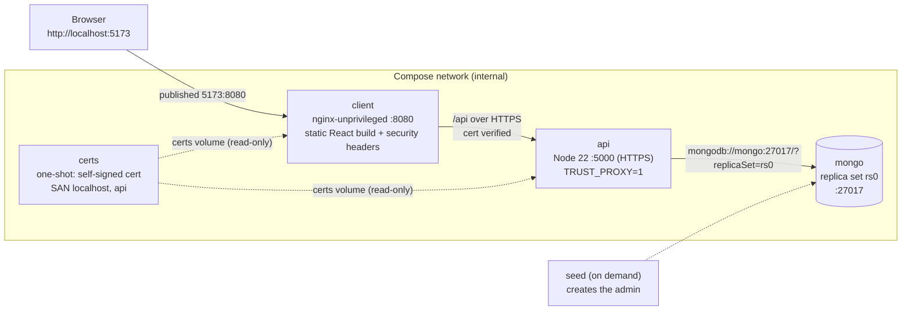

### Logs, stopping and resetting

```bash
docker compose logs -f api      # follow the API log: one JSON record per line (LOG_FORMAT=json)
docker compose down             # stop and remove the containers, keep the data
docker compose down -v          # also delete the database and the certificate (full reset)
```

### What the containers do

| Service | Image | Notes |
|---|---|---|
| `certs` | `docker/certs` (Alpine 3.24.4 + OpenSSL) | Runs once and creates a self-signed cert (SAN `localhost`, `api`, `127.0.0.1`) in the `certs` volume. Keeps an existing cert unless it expires within a day |
| `mongo` | `mongo:8.0.34-noble` | Single-member **replica set** `rs0`, because bookings and their transactions are saved in one MongoDB transaction, which a standalone server doesn't support. The healthcheck initiates the set the first time and only reports healthy once it is primary. Not published to the host; it has no authentication, so it must stay internal |
| `api` | `api/Dockerfile` (Node 22.23.4 Alpine) | `NODE_ENV=production`, HTTPS with the shared cert, `CLIENT_ORIGIN=http://localhost:5173`, `TRUST_PROXY=1`, `LOG_FORMAT=json`, and the `LOG_SHIPPING_*` values from the root `.env` as runtime variables only. Not published to the host |
| `client` | `client/Dockerfile` (Vite build, then `nginx-unprivileged` 1.31.7) | Serves the build on 8080 (published as 5173) with the same security headers as `npm run preview`, and proxies `/api` to the API |
| `seed` | the API image | Only runs when you call `docker compose run --rm seed`. The `ADMIN_*` values exist only in this short-lived container |

### Security measures in the Docker setup

- **Non-root everywhere.** The api runs as `node` (uid 1000), nginx as uid
  101, mongo as uid 999 and the cert step as uid 1000. Every service also
  has `cap_drop: [ALL]`, `no-new-privileges`, a **read-only root
  filesystem** (with a small `tmpfs` at `/tmp` only), `init: true`, a
  restart policy and a healthcheck. The API's own files are owned by root,
  so the running process can't modify them.
- **No secrets in images.** Both `.dockerignore` files are allowlists, so
  `.env`, `certs/*.pem`, keys, tests, Postman files and the host's
  `node_modules` never enter the build context. Secrets come from the root
  `.env` at runtime, and the cert is mounted read-only. The Axiom token is
  a runtime variable only, never a build argument. `docker history`, the
  image metadata and a search of each image's exported file system show
  no secret values and no key files.
- **One CSP.** The client's CSP and security headers are defined once in
  `client/securityHeaders.js`. Vite uses it for the `<meta>` tag and
  `npm run preview`, and the Docker build generates nginx's `add_header`
  lines from it. A Vitest test fails if nginx, preview and the shared file
  ever disagree. nginx also sets `server_tokens off`, caches only hashed
  `/assets/` files (one year, immutable), sends `index.html` with
  `no-cache`, and falls back to `index.html` for React Router paths.
- **TLS between nginx and the API is verified.** nginx proxies `/api` over
  HTTPS with `proxy_ssl_verify on`, trusting only the shared self-signed
  cert, whose SAN includes `api`. It passes `Host`, `X-Forwarded-For` and
  `X-Forwarded-Proto`.
- **Rate limiting behind the proxy.** Without help, every request would
  appear to come from the nginx container, so the per-IP login and register
  limits would become one global limit for all users. The API therefore
  reads `TRUST_PROXY` (unset means off, so `npm run dev` behaves exactly as
  before). Compose sets it to `1`: Express trusts exactly one proxy hop and
  takes the client address that nginx added to `X-Forwarded-For`. This is
  only safe because the API port is **not published**: if untrusted
  clients could reach the API directly, they could send a fake
  `X-Forwarded-For` and pick their own rate limit bucket. Values like
  `true` are refused for the same reason. Unit tests
  (`api/test/trustProxy.test.js`) show that with `TRUST_PROXY=1` two
  different forwarded addresses get separate buckets, that without it they
  share one, and that express-rate-limit logs no validation warnings with
  the Compose setting.
- **Fails fast.** The API exits at startup with a clear message if
  `JWT_SECRET` or `MONGO_URI` is missing (or if `JWT_SECRET` is shorter
  than 32 characters in production), instead of failing at the first
  login.
- **Health check outside the limits.** `GET /api/health` returns
  `{ "success": true, "data": { "status": "ok" } }` and nothing else. It is
  registered before the rate limiters, so healthchecks can't use up a
  limit, and it isn't written to the access log.

### Using MongoDB Atlas instead

 Set `MONGO_URI` in the root `.env` to your
Atlas connection string. The local mongo container still starts but isn't
used.

### Running Newman against the containers (test only)

`docker-compose.test.yml` is a test-only override. It publishes the API on
`127.0.0.1:5000` (loopback only) and applies the same relaxed rate limits
as `npm run start:test`. The API ignores the `RATE_LIMIT_*_MAX` overrides
when `NODE_ENV=production`, so the override sets `NODE_ENV=test`. Other
effects of that: the `JWT_SECRET` length check is skipped, `clean:test`
may run, and cloud log shipping stays off (the override also forces
`LOG_SHIPPING_IN_TEST` empty). Never use it for a real deployment.

```bash
docker compose -f docker-compose.yml -f docker-compose.test.yml up -d --build --wait
docker compose run --rm seed     # once, for the admin tests
cd api
npx newman run postman/HustleHub_API.postman_collection.json --insecure \
  --env-var base_url=https://localhost:5000 \
  --env-var admin_email=<ADMIN_EMAIL> --env-var admin_password=<ADMIN_PASSWORD>
cd ..
# remove the test users afterwards (allowed because NODE_ENV=test here)
docker compose -f docker-compose.yml -f docker-compose.test.yml run --rm --no-deps api node scripts/cleanTestData.js
# back to the normal stack (API no longer published)
docker compose up -d --wait
```

In PowerShell, put the Newman command on one line (or end each line with a
backtick instead of `\`). If port 5000 is already taken, for example by
`npm run dev`, set `$env:API_TEST_PORT = "5001"` (PowerShell) or
`export API_TEST_PORT=5001` (bash) before `up`, and use
`base_url=https://localhost:5001`.

### Docker troubleshooting

| Problem | Fix |
|---|---|
| `required variable JWT_SECRET is missing a value` | There's no root `.env`, or `JWT_SECRET=` is empty. See step 1. The root `.env` is separate from `api/.env` |
| `Bind for 0.0.0.0:5173 failed: port is already allocated` | Something is already on 5173, usually `npm run dev`. Stop it (Ctrl+C) and run `up` again. On Windows, `Get-NetTCPConnection -LocalPort 5173` shows the process |
| Port 5000 in use (test override only) | Stop `npm run dev` / `start:test`, or use `API_TEST_PORT` as described above |
| `Cannot connect to the Docker daemon` / `open //./pipe/dockerDesktopLinuxEngine` | Docker Desktop isn't running. Start it and wait until it says "Engine running" |
| `dependency failed to start: container hustlehub-mongo-1 is unhealthy`, or the API logs `MongoDB connection failed` | The replica set wasn't ready in time (slow first start). Run `docker compose up -d --wait` again: the healthcheck initiates the set on its own. Check with `docker compose logs mongo`. `docker compose down -v` resets it completely |
| Booking fails with a server error | MongoDB isn't running as a replica set. Use this Compose file (it starts `--replSet rs0`) or Atlas, not a standalone mongo |
| `exec /usr/local/bin/generate-certs: no such file or directory`, or `/bin/sh^M` | Windows line endings in a script. `.gitattributes` forces LF for shell scripts, Dockerfiles, `*.conf` and `*.yml`. If your clone predates it, run `git rm --cached -r . -q && git reset --hard` (this discards uncommitted changes) or re-clone. The cert image also strips CRs while it builds |
| The browser shows an old version after a rebuild | Hard refresh (Ctrl+F5). `index.html` is never cached, but the browser may keep an old tab |
| `429 Too many requests` from the smoke test | It registers a user each run (limit 10 per hour per IP). Wait, run `docker compose restart api` (limits are in memory), or use the test override |

## 14. Logging and monitoring

**Why we log.** The security controls in [section 8](#8-security-implementation)
(the lockout, rate limits, RBAC, ownership checks, validation) block attacks one request at a
time. Logging lets us see the pattern behind those requests: one IP
guessing passwords, one account under attack, a user trying other people's
records, a spike in errors. It also shows whether each control actually
fires. So the API writes one structured record for every security and
business event and one access line for every request. It then ships them
to a cloud logging platform (**Axiom**), where they can be searched,
charted and turned into email alerts.

### How it works

- **One logger.** Every log line goes through `api/src/utils/logger.js`
  (`logger.info/warn/error`, and `logger.event(NAME, message, fields)` for
  catalogue events). Nothing calls `console.log` directly.
- **Every record has the same fields:**
  - always: `timestamp`, `level`, `event`, `message`,
    `service` (`hustlehub-api`) and `env`
  - during a request: `requestId`, `ip`, `method`, `path` (never the query
    string), plus `userId` and `role` once the token is verified
  - the event's own safe fields, for example `reason`, `limiter`, `route`,
    `status`, `durationMs`, `amount`
- **Two console formats** (`LOG_FORMAT`). `pretty` is the readable line
  used in development, for example
  `[time] [EVENT:AUTH_LOCKOUT] Account locked after too many failed attempts {...} (req 3f2a9c1b)`.
  `json` is one JSON record per line, the default when
  `NODE_ENV=production` and in Docker.
- **Access log.** One `HTTP_REQUEST` line per request when the response
  finishes. It records the method, path, status, duration and user, and
  never headers, bodies or query strings. Levels: 5xx is `error`, 4xx is
  `warn`, everything else `info`. The health check (polled by Docker every
  few seconds) and CORS preflights are skipped.
- **Crashes and shutdown.** An unhandled promise rejection is logged and
  the server carries on. An uncaught exception is logged, the queue is
  flushed (at most 2 seconds), and the process exits with code 1. On
  `SIGTERM` (Docker stop) or `SIGINT` (Ctrl+C), queued records are sent
  first. The shipper then prints its own counts (`Cloud log shipping
  summary`), to the console only.

### Event catalogue

The names are stable (`api/src/utils/logEvents.js`), because the saved
queries and monitors search for them. A unit test checks that every
`logger.event()` call in the code uses a catalogue name.

| Event | When it fires | Key fields | Why it matters / what it helps detect |
|---|---|---|---|
| `AUTH_REGISTER` | An account is created, or refused because the email exists (`warn`) | `outcome`, `reason`, `userId`, `role`, masked `email`, `ip` | Mass sign-ups (bots), email enumeration attempts |
| `AUTH_LOGIN_SUCCESS` | A correct login | `userId`, `role`, `ip` | Account takeover: a login from an unusual IP right after many failures |
| `AUTH_LOGIN_FAILURE` | Any failed login | `reason` (`bad_credentials` or `locked`, internal only), masked `email`, `userId` if the account exists, `ip` | **Brute force** and **password spraying** (many failures per IP, or one IP against many accounts). The response is always the same generic 401 |
| `AUTH_LOCKOUT` | The 5th wrong password in 15 minutes locks the account | `userId`, `failedAttempts`, `lockMinutes`, `ip` | A targeted attack on one account. Also proves the lockout works |
| `AUTH_PASSWORD_CHANGED` | A password change succeeds (every other session ends) | `userId`, `ip` | Account takeover: an unexpected change is a red flag |
| `AUTH_PASSWORD_CHANGE_FAILED` | Wrong current password, or a locked account | `reason`, `userId`, `ip` | Someone with a stolen session trying to take over the account |
| `AUTH_LOGOUT_ALL` | "Sign out of all devices" | `userId`, `ip` | A user reacting to a suspected stolen session |
| `ACCESS_DENIED` | A 401 from `protect` (no, invalid, expired or revoked token, user gone), a 403 for the wrong role or not the owner, or a blocked CORS origin | `reason`, `status`, `route` (the route pattern, for example `/api/gigs/:id`), `userId`/`role` when known | **Privilege abuse** (a client calling freelancer or admin routes), **IDOR probing** (`not_owner`), stolen or forged tokens, use of a token after a password change |
| `RATE_LIMIT_EXCEEDED` | Any limiter answers 429 | `limiter` (`login`, `register`, `booking`, `passwordChange`, `general`), `ip`, `route`, `retryAfterSeconds` | Brute force, **booking spam or fraud**, scraping, denial-of-service attempts |
| `VALIDATION_FAILED` | A request fails validation, schema checks or body parsing | `source`, **field names only** (never values), `reason` | Fuzzing and injection attempts, broken clients |
| `INPUT_SANITIZED` | `$` or `.` operator keys were stripped from the input | `location` (body/query/params), `ip` | **NoSQL injection** attempts. Normal clients never send these |
| `GIG_CREATED` / `GIG_UPDATED` / `GIG_DELETED` | A freelancer changes their own gig | `gigId`, `price`, `fields`, `deactivated` | Who changed what and when (for example a price hiked after bookings) |
| `BOOKING_CREATED` | A booking is saved | `bookingId`, `gigId`, `clientId`, `freelancerId`, `price` | **Booking fraud** (bursts from one client), business volume |
| `BOOKING_FAILED` | A booking was refused or rolled back (nothing saved) | `gigId`, `reason` | Attempts to book hidden or deleted gigs, database trouble |
| `TRANSACTION_CREATED` | The (simulated) payment record for a booking | `reference`, `amount`, `transactionId`, `bookingId`, `clientId`, `freelancerId` | Income tracking. The count must match `BOOKING_CREATED` |
| `ADMIN_ACTION` | An admin lists users or transactions, views the audit log, or removes a gig, and when the admin is seeded | `action`, `gigId`, `count` | **Privilege abuse by an admin**: admins are powerful, so every admin read is logged too |
| `AUDIT_WRITE_FAILED` | An audit log entry could not be saved (the action still succeeded) | `action`, `errorName` | A gap in the audit trail. Should never happen |
| `ERROR_UNHANDLED` | A 5xx, an unhandled rejection or an uncaught exception | `errorName`, `errorMessage`, `status`, `source` | **Outages** and bugs: database down, crashes. Never includes a stack trace |
| `SERVER_START` / `SERVER_STOP` | The API starts listening / receives SIGTERM or SIGINT | `port`, `nodeEnv`, `logFormat`, `cloudLogging` (on, or why it is off) | Restarts and crash loops, and confirms the settings in use |
| `HTTP_REQUEST` | Every request (the access log) | `status`, `durationMs`, `method`, `path` | Error rates, slow routes, traffic spikes |
| `APP_LOG` | Plain `logger.info/warn/error` lines (startup settings, 4xx messages, database connection changes) | varies | Context around the events above |
| `LOG_TEST` | Only from `npm run log:test` | `source`, `test` | Confirms the connection to Axiom |

Real examples of every one, as they arrived at the receiver, are in
[`docs/logging-evidence/sample-events.jsonl`](docs/logging-evidence/sample-events.jsonl).

### Request-id correlation

Every request gets a new id from `crypto.randomUUID()`. It is returned in
the `X-Request-Id` response header and stored in an `AsyncLocalStorage`
context, so **every** record written while that request is handled
carries the same `requestId`. That includes records from controllers,
middleware, the lockout code and the audit log helper. The middleware is
in `api/src/middleware/requestLogging.js`.

An `X-Request-Id` sent by the client is ignored. Otherwise a caller could
make its requests look like someone else's in the logs. Response bodies
are unchanged.

In practice, if a user reports an error, the id from the browser's network
tab, pasted into Axiom (query 7 in
[`axiom-queries.md`](docs/logging-evidence/axiom-queries.md)), shows
everything that happened in that request, in order.

### Redaction rules

One scrubber (`api/src/utils/redact.js`) cleans every record **before**
it is printed and **before** it is shipped:

- **Sensitive keys.** The value under any key containing `password`,
  `token`, `secret`, `authorization`, `cookie`, `jwt`, `mongo_uri`,
  `api key`, `credential` and similar is replaced with `[REDACTED]`, at any
  depth and in any letter case.
- **Secrets inside text.** In any string, these become `[REDACTED_...]`:
  JWTs (`eyJ...`), Axiom tokens (`xaat-...`), `Bearer ...` values, and the
  `user:password@` part of connection strings such as `mongodb://`.
- **Emails** are masked in the existing style (`jane@example.com` becomes
  `j***@example.com`).
- **No stack traces.** An `Error` becomes `{ name, message }`, with no
  stack trace and no file paths.
- **Log injection.** CR, LF and other control characters become spaces, so
  input can't forge a fake log line.
- **Limits.** Strings are cut at 512 characters, nesting at 6 levels, and
  objects and arrays at 50 entries. Circular references are marked. A
  record over 16 KB keeps only its headline fields.
- **Never throws.** Anything the scrubber can't read becomes a placeholder.

On top of that, the code never passes passwords, tokens, request bodies,
headers or query strings to the logger in the first place.
`api/test/redact.test.js` has a unit test for each rule.

### How logs reach Axiom

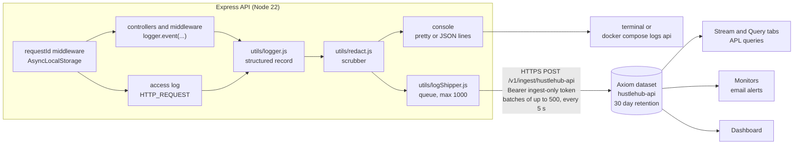

The shipper (`api/src/utils/logShipper.js`) uses Node's built-in `fetch`,
so it adds no new dependencies:

- **Batching.** It sends every 5 seconds, or as soon as 100 records are
  waiting, at most 500 per request, with a 5 second timeout.
- **Retries.** Network errors, timeouts, 5xx and 429 are retried with
  exponential backoff (0.5 s, then 1 s; 3 tries in all). Other 4xx are
  never retried, because a bad token won't fix itself.
- **A bounded queue.** It holds at most 1000 records. When full, the
  oldest are dropped and counted.
- **Never in the way.** Queuing is synchronous and cheap, the timers don't
  keep the process alive, and a failure never blocks or breaks a request.
- **Its own problems stay local.** Shipping problems are printed to the
  console at most once a minute, without the URL or token, and are never
  shipped, so a failing shipper can't feed itself.
- **Accounting.** It tracks the records `sent`, `ingested` and `failed`
  (from Axiom's reply), and `dropped` and `lost`.

### Configuration

| Setting | Default | What it does |
|---|---|---|
| `LOG_FORMAT` | `pretty` in development, `json` when `NODE_ENV=production` and in Docker | Console format |
| `LOG_SHIPPING_URL` | empty (off) | `https://<edge-domain>/v1/ingest/<dataset>`. Must be `https` (plain `http` is accepted only to `localhost` in a test run) |
| `LOG_SHIPPING_TOKEN` | empty (off) | The Axiom API token. Secret: `.env` only, never committed, never logged |
| `LOG_SHIPPING_IN_TEST` | off | Set to `1` to ship from a test run anyway (for a demo) |

When shipping is on:

| Run | Ships to Axiom? |
|---|---|
| `npm run dev`, `npm start`, `docker compose up` with both `LOG_SHIPPING_*` set | **Yes** |
| Either setting empty (the default in both `.env.example` files, and in CI) | No: console only |
| `npm test`, `npm run start:test`, `npm run start:test:strict`, `NODE_ENV=test`, the Compose test override | No, unless `LOG_SHIPPING_IN_TEST=1` (the Compose test override forces it empty) |

So the Newman runs, the Vitest run, the unit tests and the CI pipeline
never fill the dataset with test data, and CI needs no new secrets. The
values reach the `api` container as **runtime** environment variables
only, never as build arguments. The token is never in an image layer, and
`.env` is in `.dockerignore`.

**Check the connection:** `cd api; npm run log:test` sends one labelled
`LOG_TEST` event. It prints only the HTTP status and Axiom's `ingested`
and `failed` counts, never the URL or the token. A 401 or 403 means the
token is wrong or can't write to the dataset. A 404 means the dataset
name or the domain is wrong.

### Setting up Axiom (free Personal plan)

1. Sign up at axiom.co on the free **Personal** plan. It keeps data for
   30 days and allows 3 monitors and email notifiers.
2. Create a dataset named **`hustlehub-api`**.
3. Create the token in **Settings > API tokens > New API token**:
   - choose **Basic** (the type that can only ingest)
   - under **Dataset access**, select **only `hustlehub-api`**
   - click **Create** and copy the token (it is shown once)

   Never use a personal access token or a token with wider rights. If
   this token leaks, the worst anyone can do is write noise into one
   dataset: they can't read, query or delete anything.
4. Put the values in the gitignored `api/.env` (for `npm run dev`) and the
   root `.env` (for Docker):
   - `LOG_SHIPPING_URL=https://<edge-domain>/v1/ingest/hustlehub-api`,
     where the edge domain (for example US East 1) is shown under
     Settings > General
   - `LOG_SHIPPING_TOKEN=<the token>`
5. Run `npm run log:test` and expect `HTTP 200, ingested: 1, failed: 0`.
6. Paste the queries from
   [`docs/logging-evidence/axiom-queries.md`](docs/logging-evidence/axiom-queries.md)
   into the **Query** tab, and create the three suggested monitors.

If the token is ever exposed, regenerate it in Settings > API tokens and
update both `.env` files.

### Personal data, retention and POPIA

What reaches Axiom, and why:

| Data | Why |
|---|---|
| User id (an opaque database id) and role | To tell which account a security event concerns without storing who the person is |
| Masked email (`j***@example.com`), only on failed logins and duplicate registrations | To spot attacks on an address that has no account yet (so no user id) without storing the address itself |
| IP address | The main signal for brute force, spraying and rate limit abuse |
| Method, path (no query string), status, timing | To see which routes are attacked, failing or slow |
| Booking and transaction ids, references and amounts | To trace income and spot booking fraud |

What never reaches it: names, full emails, passwords or hashes, tokens,
request and response bodies, headers, query strings and stack traces.

**Retention:** Axiom's free plan keeps data for **30 days** and then
deletes it. Console logs last as long as the terminal or the Docker
container.

**POPIA** (South Africa's Protection of Personal Information Act). IP
addresses and user ids linked to an account can identify a person, so
they count as personal information. The design follows these POPIA
conditions:

- **Purpose specification:** logs are used for security and operations
  only.
- **Minimality (section 10):** only the fields in the table above, with
  emails masked.
- **Retention:** 30 days.
- **Security safeguards (section 19):** an ingest-only token, HTTPS and
  redaction.

This is a student project, not a legal assessment. A real deployment
would also need:

- a privacy notice that tells users about this logging
- a written operator agreement with Axiom (sections 20 and 21)
- a check of the rules for sending personal information outside South
  Africa (section 72), because the dataset is hosted in the US
- a process for reporting a security compromise (section 22)

### Do the controls work? What the logs show

| Control | Evidence in the logs | Axiom query |
|---|---|---|
| Account lockout | `AUTH_LOCKOUT` after the 5th wrong password, then `AUTH_LOGIN_FAILURE` with `reason: locked` for the correct password | 2 |
| Login and booking rate limits | `RATE_LIMIT_EXCEEDED` with the `limiter` name, and `HTTP_REQUEST` with status 429 | 4 |
| RBAC | `ACCESS_DENIED` `wrong_role` 403 (for example a client opening `/api/income`) | 3 |
| Ownership (no IDOR) | `ACCESS_DENIED` `not_owner` 403 on `/api/gigs/:id` | 3 |
| Session revocation | `AUTH_PASSWORD_CHANGED` or `AUTH_LOGOUT_ALL`, then `ACCESS_DENIED` `revoked_token` 401 for the old token | 3 (without the 403 filter) |
| Validation and NoSQL sanitising | `VALIDATION_FAILED` (field names) and `INPUT_SANITIZED` | add `where event == "INPUT_SANITIZED"` |
| CORS | `ACCESS_DENIED` `cors_origin` | 3 (without the 403 filter) |
| Booking integrity | `BOOKING_CREATED` and `TRANSACTION_CREATED` counts always match | 5 |
| Audit log | `AUDIT_WRITE_FAILED` count stays at 0 | 6 |
| Safe error handling | `ERROR_UNHANDLED` with the error name only (no stack trace), while the client gets a generic message | 6 |

Each of these was triggered and seen in the local mock check
([`mock-shipping-check.txt`](docs/logging-evidence/mock-shipping-check.txt)),
and a smaller set was shipped to the real Axiom dataset
([`live-shipping-check.txt`](docs/logging-evidence/live-shipping-check.txt)).

**Limitations:**

- **Best effort.** Shipping is best effort: during a long outage,
  records beyond the queue cap are dropped (and counted), and records
  still queued when the process is killed hard are lost. The console copy
  is always complete.
- **Trust.** The logs are only as trustworthy as the server that writes
  them. A compromised server could stop logging, which is why monitors
  that alert on *missing* data are worth adding.
- **Thresholds.** The monitor thresholds are guesses for a small project.
  They should be tuned against real traffic.

## 15. Demonstration evidence

### Evidence folders

| Folder | What is in it |
|---|---|
| [`docs/test-evidence/`](docs/test-evidence/README.md) | Raw output of every test run: api unit tests, both Newman collections (local and Docker), Vitest, the Docker smoke test and `docker compose ps` |
| [`docs/pipeline-evidence/`](docs/pipeline-evidence/README.md) | The pipeline's checks run locally (actionlint, zizmor, hadolint, Compose config, npm audit, gitleaks, Trivy, ZAP) and the status of the remote run under the billing lock |
| [`docs/static-analysis/`](docs/static-analysis/README.md) | ESLint and Semgrep results before any fix (`baseline/`) and after (`final/`), as text, JSON and SARIF |
| [`docs/logging-evidence/`](docs/logging-evidence/README.md) | Real sample log records for every event, JSON lines from the API container, the mock and live Axiom checks, and ready-to-paste Axiom queries |
| [`docs/screenshots/`](docs/screenshots/README.md) | The screenshots below |

### Part 3 screenshots

Taken from the running Docker stack on 9 November 2026 with throwaway
accounts. The admin's email is greyed out on the Users page.

| File | What it shows |
|---|---|
| [`part3-01-income-dashboard.png`](docs/screenshots/part3-01-income-dashboard.png) | The freelancer's Income dashboard for 2026/27: R 300 000,00 earned from 3 bookings, R 40 572,00 estimated tax, R 259 428,00 take-home, 13,52% effective rate, the chart, the bracket table, the assumptions and the income per booking |
| [`part3-02-chart-hover.png`](docs/screenshots/part3-02-chart-hover.png) | The monthly chart with November hovered: "R 300 000,00 · 3 bookings" |
| [`part3-03-tax-by-bracket.png`](docs/screenshots/part3-03-tax-by-bracket.png) | The tax by bracket table, matching the worked example in [Tax estimation](#7-tax-estimation) |
| [`part3-04-assumptions-disclaimer.png`](docs/screenshots/part3-04-assumptions-disclaimer.png) | How the estimate works: the assumptions, the disclaimer and the SARS source |
| [`part3-05-empty-tax-year.png`](docs/screenshots/part3-05-empty-tax-year.png) | The 2025/26 tax year with no income, with that year's brackets and rebate |
| [`part3-06-dashboard-phone.png`](docs/screenshots/part3-06-dashboard-phone.png) | The dashboard at phone width (390 px) |
| [`part3-07-account-validation.png`](docs/screenshots/part3-07-account-validation.png) | The Account page after an empty submit: an inline error under each field |
| [`part3-08-account-wrong-current.png`](docs/screenshots/part3-08-account-wrong-current.png) | A wrong current password: a `400` message, and the user stays logged in |
| [`part3-09-account-success.png`](docs/screenshots/part3-09-account-success.png) | "Password changed. You have been signed out everywhere else." |
| [`part3-10-lockout-correct-password-rejected.png`](docs/screenshots/part3-10-lockout-correct-password-rejected.png) | After 5 wrong passwords the correct password is still refused with "Invalid email or password" |
| [`part3-11-session-ended.png`](docs/screenshots/part3-11-session-ended.png) | A second browser for the same user after the password was changed in the first: it lands on Log in with "Your session has ended. Please log in again." |
| [`part3-12-sign-out-confirm.png`](docs/screenshots/part3-12-sign-out-confirm.png) | The "Sign out of all devices?" confirmation |
| [`part3-13-signed-out-all-devices.png`](docs/screenshots/part3-13-signed-out-all-devices.png) | Log in after "Sign out of all devices": "You have been signed out of all devices. Log in again to continue." |
| [`part3-14-audit-log.png`](docs/screenshots/part3-14-audit-log.png) | The admin Audit log: account locked, signed out of all devices, password changed, admin deleted a gig |
| [`part3-15-audit-log-filtered.png`](docs/screenshots/part3-15-audit-log-filtered.png) | The Audit log filtered to "Password changed" |
| [`part3-16-admin-users.png`](docs/screenshots/part3-16-admin-users.png) | The admin Users page |
| [`part3-17-admin-transactions.png`](docs/screenshots/part3-17-admin-transactions.png) | The admin All transactions page: each transaction linked to its client and freelancer |
| [`part3-18-client-transactions.png`](docs/screenshots/part3-18-client-transactions.png) | The client's My transactions with each `TXN-...` reference |

### Part 2 screenshots

These were taken for Part 2. The pages look the same today apart from the
new Account and Audit log links and the income page, which is now the tax
dashboard.

| File | What it shows |
|---|---|
| [`01-register.png`](docs/screenshots/01-register.png) | Register page with inline "Name is required", "Email is required" and "Password is required" errors; only Client or Freelancer can be chosen |
| [`02-login.png`](docs/screenshots/02-login.png) | Login page with the generic "Invalid email or password" message, so accounts can't be enumerated |
| [`03-browse-gigs.png`](docs/screenshots/03-browse-gigs.png) | A client browsing gigs with search, category and price filters; freelancers shown by name only |
| [`04-create-gig.png`](docs/screenshots/04-create-gig.png) | A freelancer's New gig form; there is no owner field, because the API takes the owner from the token |
| [`05-my-gigs.png`](docs/screenshots/05-my-gigs.png) | My gigs: only the freelancer's own gigs, with Active and Inactive badges |
| [`06-book-confirm.png`](docs/screenshots/06-book-confirm.png) | The booking confirmation step: title, price R 450,00 from the database and the "Payment is simulated" notice |
| [`07-booking-confirmed.png`](docs/screenshots/07-booking-confirmed.png) | Booking confirmed with transaction reference TXN-20261012-889A22AF615D |
| [`08-client-bookings.png`](docs/screenshots/08-client-bookings.png) | A client's My bookings: only their own bookings, each at the price it was booked at |
| [`09-freelancer-income.png`](docs/screenshots/09-freelancer-income.png) | A freelancer's income (Part 2 version of the page, before the tax dashboard): R 750,00 from 2 bookings, including the reference from screenshot 7 |
| [`10-admin-transactions.png`](docs/screenshots/10-admin-transactions.png) | The admin's All transactions: every transaction linked to its client and freelancer |
| [`11-newman-pass.png`](docs/screenshots/11-newman-pass.png) | Part 2 run of the main collection: 80 requests and 134 assertions, 0 failed, without admin credentials (the current run is 131 and 246, see [Testing](#10-testing)) |
| [`11b-newman-rate-limits.png`](docs/screenshots/11b-newman-rate-limits.png) | The rate limit collection: 20 requests and 26 assertions, 0 failed |
| [`12-vitest-pass.png`](docs/screenshots/12-vitest-pass.png) | Part 2 Vitest run: 16 files and 67 tests passed (now 21 files and 110 tests) |
| [`13-security-headers.png`](docs/screenshots/13-security-headers.png) | API response headers in DevTools: CSP, cross-origin policies, no-referrer, HSTS, nosniff, and no `X-Powered-By` |
| [`13b-security-headers-continued.png`](docs/screenshots/13b-security-headers-continued.png) | The rest of the Helmet headers, including `X-Frame-Options: DENY` |
| [`14-rate-limit-429.png`](docs/screenshots/14-rate-limit-429.png) | The 6th failed login refused with "Too many requests, please try again in 896 seconds." |
| [`part1/`](docs/screenshots/part1/) | Part 1 Postman screenshots: health check, registration (success, duplicate, invalid), login (success, wrong password), protected route (no token, valid token) |

The two billing lock images are shown in
[Pipeline status and the billing lock](#pipeline-status-and-the-billing-lock).

### Demonstration videos

- **Part 3 demonstration video:** the link is added at submission.
- **Part 2:** https://youtu.be/H5GcOdMPQNw (registration and login, gig
  creation, booking creation and viewing, transaction recording,
  role-based access, the security headers, the tests and rate limiting)
- **Part 1** (API only): https://youtu.be/qTK6iV_0lmI

[](https://youtu.be/H5GcOdMPQNw)

## 16. What changed in Part 3

| Change | Where it lives | Rubric row it serves |
|---|---|---|
| South African income tax estimate (SARS brackets, rebate, tax-free threshold, whole-cent maths, tax years in SA time) and `GET /api/income/tax-estimate` | `api/src/config/tax.js`, `api/src/utils/taxCalculator.js`, `taxYear.js`, `taxEstimate.js`, `api/src/controllers/incomeController.js`, `api/src/middleware/incomeValidators.js` | Tax estimation and income dashboard |
| Income dashboard: summary cards, monthly SVG chart, tax-by-bracket table, assumptions and disclaimer | `client/src/pages/Income.jsx`, `client/src/components/MonthlyIncomeChart.jsx`, `TaxBreakdownTable.jsx` | Tax estimation and income dashboard |
| Dockerfiles for the API, the client and the certificate step; Compose stack with a MongoDB replica set; a test-only override; container hardening; a smoke test | `api/Dockerfile`, `client/Dockerfile`, `client/nginx.conf`, `docker/`, `docker-compose.yml`, `docker-compose.test.yml` | Docker and Docker Compose |
| `TRUST_PROXY` so per-IP rate limits work behind nginx; startup checks for required settings; a health check outside the rate limits | `api/src/config/proxy.js`, `api/src/config/env.js`, `api/src/app.js`, `api/scripts/healthcheck.js` | Docker and Docker Compose |
| One shared source for the client's CSP and headers, plus `Permissions-Policy` and cross-origin isolation headers | `client/securityHeaders.js`, `client/scripts/nginx-security-headers.mjs`, `client/vite.config.js` | Security (headers); CI/CD (ZAP findings fixed) |
| GitHub Actions pipeline: unit tests, Vitest, npm audit, gitleaks, hadolint, Compose config, actionlint, zizmor, the full stack with the smoke test and both Newman collections, Trivy, ZAP, static analysis, and one Pipeline OK gate; credentials generated per job | `.github/workflows/ci.yml`, `.github/scripts/`, `.zap/rules.tsv` | CI/CD pipeline |
| Dependabot with a 7-day cooldown | `.github/dependabot.yml` | CI/CD pipeline; static analysis (a Semgrep finding) |
| ESLint with eslint-plugin-security in both packages and Semgrep with 7 rule packs; 126 baseline findings fixed or justified, 0 left | `api/eslint.config.js`, `client/eslint.config.js`, `.semgrep/`, `docs/static-analysis/` | Static code analysis |
| Fixes from static analysis: a fixed `Host` header in nginx, a ReDoS-safe price regex, prototype-safe lookups | `client/nginx.conf`, `api/src/middleware/gigValidators.js`, `client/src/utils/validation.js`, `api/src/utils/taxEstimate.js`, `client/src/utils/text.js` | Static code analysis |
| Account lockout (5 failures in 15 minutes lock for 15 minutes, counted atomically, no enumeration) | `api/src/config/lockout.js`, `api/src/utils/lockout.js`, `api/src/utils/accountLockout.js` | Additional security features |
| Change password and session revocation (token versions), "Sign out of all devices", the Account page; the 72-byte password limit; a `typeof` check on the login password | `api/src/controllers/authController.js`, `api/src/middleware/authMiddleware.js`, `api/src/utils/generateToken.js`, `client/src/pages/Account.jsx` | Additional security features |
| Append-only admin audit log and the admin Audit log page | `api/src/models/AuditLog.js`, `api/src/utils/audit.js`, `api/src/controllers/adminController.js`, `client/src/pages/AdminAuditLog.jsx` | Additional security features |
| Structured logging: event catalogue, request ids, access log, redaction, `LOG_FORMAT`, crash and shutdown handling | `api/src/utils/logger.js`, `logEvents.js`, `redact.js`, `requestContext.js`, `api/src/middleware/requestLogging.js`, `api/src/server.js` | Logging and monitoring |
| Cloud logging to Axiom with batching, retries and a bounded queue; `npm run log:test`; `npm run start:test:strict`; Axiom queries and monitors | `api/src/utils/logShipper.js`, `api/scripts/sendTestLog.js`, `api/scripts/startTest.js`, `docs/logging-evidence/` | Logging and monitoring |
| New tests: 191 api unit tests (from 0 in Part 2), 110 Vitest tests (from 67), 151 Newman requests (from 105) | `api/test/`, `client/src/**/*.test.*`, `api/postman/` | Testing across every row |
| Final security review (threats, controls, evidence, residual risks) | [Section 9](#9-final-security-review) | Security review |
| This README, rewritten to match the final system | `README.md`, `docs/*/README.md` | README update |

## 17. Requirements traceability

### Part 3 requirements

| Requirement (from the brief) | Where it is satisfied | Evidence |
|---|---|---|
| Tax estimate and an income dashboard with charts or summaries, with the logic explained | `GET /api/income/tax-estimate` and the Income dashboard; logic and worked example in [Tax estimation](#7-tax-estimation) | `taxCalculator.test.js` (worked example), `taxYear.test.js`, `taxConfig.test.js`, `taxEstimate.test.js`; Newman Income folder (14 requests, 35 assertions); `Income.test.jsx`, `MonthlyIncomeChart.test.jsx` |
| GitHub Actions pipeline: install, backend tests, frontend tests, Newman, security scans, builds the whole stack, fails when any check fails | [`.github/workflows/ci.yml`](.github/workflows/ci.yml); [CI/CD pipeline](#11-cicd-pipeline) | **The remote run is blocked by the account billing lock**: GitHub starts no job ("The job was not started because your account is locked due to a billing issue."). Every job was run locally with the same commands and passed, and failing closed was proven: see [Pipeline status and the billing lock](#pipeline-status-and-the-billing-lock), [`docs/pipeline-evidence/`](docs/pipeline-evidence/README.md) and [`docs/test-evidence/`](docs/test-evidence/README.md) |
| Static analysis in the pipeline, with evidence and the fixes explained | ESLint and Semgrep, in the pipeline's static analysis job; [Static code analysis](#12-static-code-analysis) | [`docs/static-analysis/`](docs/static-analysis/README.md): 126 findings at baseline, 0 at the end; the fixes table with commits; fails-closed proof |
| Dockerfiles in `api/` and `client/` plus Docker Compose, both running in the pipeline | `api/Dockerfile`, `client/Dockerfile`, `docker-compose.yml`, `docker-compose.test.yml`; [Docker](#13-docker) | [`docker-compose-ps.txt`](docs/test-evidence/docker-compose-ps.txt) (healthy, non-root), [`docker-smoke-test-results.txt`](docs/test-evidence/docker-smoke-test-results.txt) (15 checks), [`docker-newman-results.txt`](docs/test-evidence/docker-newman-results.txt) (131 requests, 246 assertions); hadolint and Trivy clean. Run in the pipeline's stack job (verified locally, see the billing lock) |
| Logging of login, booking, transaction and error events, with a README explanation and cloud logging evidence | Structured logger and Axiom shipper; [Logging and monitoring](#14-logging-and-monitoring) | [`docs/logging-evidence/`](docs/logging-evidence/README.md): sample records for all 25 events, the mock check (90 records), the live check (Axiom accepted 39 records, 0 failed), APL queries and monitors; `logger.test.js`, `redact.test.js`, `logShipper.test.js`, `requestLogging.test.js` |
| At least two extra security features | Three: account lockout, change password with session revocation, and the admin audit log; [Extra security features](#extra-security-features) | `lockout.test.js`, `tokenVersion.test.js`, `auditLog.test.js`; Newman Account security folder (36 requests, 69 assertions); `Account.test.jsx`, `AdminAuditLog.test.jsx` |
| A threat-to-control security review in the README | [Final security review](#9-final-security-review) | Each row names a test, scan or log event; the effectiveness table has the real results |
| Final README | This document | Every count and command checked against a run on 9 November 2026 |
| Demonstration video | [Demonstration videos](#demonstration-videos) | The Part 3 link is added at submission |

### Part 2 requirements (still met)

| # | Requirement | Where | Evidence |
|---|---|---|---|
| 1 | Full-stack MERN | `client/`, `api/src/`, MongoDB through Mongoose | Every test run uses the real stack |
| 2 | Freelancers manage only their **own** gigs | `gigController.js`, `ownership.js`, `gigValidators.js` | Newman Gigs folder (`403` for others, `400` for a `freelancer` field) |
| 3 | React frontend: register, log in, browse, book; invalid input handled; nothing sensitive shown | `client/src/pages/`, `client/src/utils/validation.js`, `text.js` | Vitest (110 tests), screenshots 1 to 3 |
| 4 | Every booking creates a transaction linked to both users | `bookingController.js` (one database transaction), unique index | Newman Bookings folder; screenshots 6 to 8 and 10 |
| 5 | Freelancers see their bookings; income per freelancer | `/api/bookings/mine`, `/api/income`, `FreelancerBookings.jsx`, `Income.jsx` | Newman Income folder; screenshot 9 |
| 6 | JWT on protected routes, RBAC, input sanitised | `authMiddleware.js`, `ownership.js`, validators, `sanitize.js` | Newman Auth, RBAC and Security folders; route audit |
| 7 | Rate limiting with a meaningful response | `rateLimiters.js`, `config/rateLimits.js` | Rate limit collection (20 requests, 26 assertions); screenshot 14 |
| 8 | Helmet headers with a restrictive CSP | `api/src/config/security.js`, `client/securityHeaders.js` | Newman "Security Headers"; ZAP 0 FAIL; screenshots 13 and 13b |
| 9 | Postman and Newman tests; frontend tests for rendering and interaction | `api/postman/`, `client/src/**/*.test.*` | [`docs/test-evidence/`](docs/test-evidence/README.md) |
| 10 | README: features, security, how to run, testing | This document | |
| 11 | Demonstration video | Part 2 video | https://youtu.be/H5GcOdMPQNw |

## 18. Troubleshooting, limitations, team and repository

### Troubleshooting

These problems all came up while building and testing the project. Docker
problems are in [Docker troubleshooting](#docker-troubleshooting).

| Problem | Cause | Fix |
|---|---|---|
| The API exits with `MongoDB connection failed {"errorName":"Error","code":"ECONNREFUSED"}` and the SRV lookup (`querySrv ECONNREFUSED`) fails, although Atlas is reachable | On some Windows networks Node can't resolve the DNS SRV record a `mongodb+srv://` string needs | Use the standard (non-SRV) connection string: in Atlas, Connect, Drivers, choose the "Legacy URI String" option. It looks like `mongodb://host1:27017,host2:27017,host3:27017/hustlehub?replicaSet=...&ssl=true&authSource=admin` |
| The API exits with `MongoDB connection failed` (other codes) | Wrong database user or password, or your IP isn't allowed | Check the user and password, and add your IP under Atlas **Network Access** |
| `Startup aborted: JWT_SECRET is not set` or `MONGO_URI is not set` | A required setting is missing from `api/.env` | Copy `api/.env.example` to `api/.env` and fill it in |
| The API logs `No SSL certificate found in api/certs`; the client gets `502` and Vite logs `EPROTO ... wrong version number`; Newman fails | The certificate doesn't exist, so the API runs on plain HTTP | Run `npm run certs` in `api/` and restart the API |
| Every save, login or booking fails with **"Origin not allowed"** (`403`) | The client isn't on `http://localhost:5173`, the only origin `CLIENT_ORIGIN` allows | Run the client on port 5173, keep `CLIENT_ORIGIN=http://localhost:5173` with no trailing slash, and use `localhost`, not `127.0.0.1` |
| `Port 5173 is already in use` (Vite) | Another dev or preview server is running; both refuse to switch ports, because another port would fail CORS | Stop the other one and start again |
| `EADDRINUSE: address already in use :::5000` | Another copy of the API is still running (for example an earlier `start:test`) | Stop it. Windows: `netstat -ano \| findstr :5000`, then `taskkill /PID <pid> /F`; macOS and Linux: `lsof -i :5000`. Don't just change `PORT`: the client proxy and the collections expect 5000 |
| `429 Too many requests, please try again in N seconds` while testing | The strict limits are working | Use `npm run start:test` for repeated testing. The counters are in memory, so restarting the API clears them |
| The correct password is rejected right after several wrong ones | The account is locked for 15 minutes | Wait 15 minutes. For local testing the policy can be changed with the `LOCKOUT_*` variables (ignored in production) |
| Bookings fail with a `500` on a local MongoDB | A standalone MongoDB doesn't support the booking's database transaction | Use Atlas, Docker, or a local single-node replica set |
| `npm run log:test` prints `HTTP 401` or `HTTP 403` | The Axiom token is wrong or can't ingest into the dataset | Create a Basic token with access to the dataset and update both `.env` files |
| `npm run log:test` prints `HTTP 404` | The dataset name or the edge domain in `LOG_SHIPPING_URL` is wrong | Check the URL against Axiom's Settings |
| Nothing arrives in Axiom from `npm run start:test` | Test runs never ship | Set `LOG_SHIPPING_IN_TEST=1` for a demo, or use `npm run dev` |

### Known limitations

The security limitations are listed in
[Residual risks and accepted limitations](#residual-risks-and-accepted-limitations).
Beyond those:

- **Payments are simulated.** A transaction is created as `completed` with
  a reference; no payment provider is involved and there is no refund
  flow.
- **The tax estimate** treats income to date as the whole year's income,
  applies only the primary rebate and no deductions, and supports only the
  tax years in its table (see [Tax estimation](#7-tax-estimation)).
- **Sessions** can be ended all at once but not one device at a time, and
  a locked account simply waits 15 minutes (no unlock by email).
- **The audit log** keeps entries forever, with no retention policy.
- **Logs in Axiom** are kept for 30 days on the free plan, and monitors
  have to be created by hand in Axiom.
- **The login page doesn't explain why it opened.** After a session ends
  (another device changed the password, or "Sign out of all devices"),
  the app correctly lands on Log in, but without the "Your session has
  ended" or "You have been signed out of all devices" message that
  `Login.jsx` has for this. The client sends the message along when it
  navigates, but `ProtectedRoute` redirects at the same moment with its
  own state and replaces it. The security behaviour (the old token is
  refused with `401`) is not affected.

### Team and repository

**Group:** Null Devs
**Group Leader:** Muaaz (ST10443760)
**Module:** INSY7314/w (Information Systems 3D) and APDS7311/w (Application
Development Security)
**Repository:** <https://github.com/EMKNDW/insy7314-g2-2026-insy7314-2026-poe-st10443760>
(the `main` branch is the graded version)
